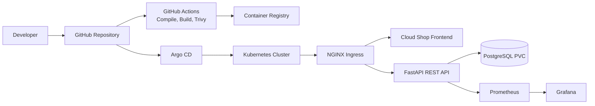

# Cloud Shop — Complete Argo CD GitOps E-Commerce Application

Cloud Shop is a lightweight, production-inspired e-commerce application designed to demonstrate modern containerization, Kubernetes operations, GitOps delivery, CI security, and observability on a small Ubuntu 24.04 learning VM.

It includes a FastAPI REST API, PostgreSQL database, static NGINX frontend, Docker Compose, Kubernetes manifests, Kustomize, Helm, Argo CD, NGINX Ingress, Prometheus metrics, GitHub Actions, and Trivy image scanning.

> **Important:** This repository is a learning and portfolio project. The local configuration is intentionally small. Before production use, add managed database infrastructure, TLS, external secrets, stronger authentication, backups, network policies, image signing, high availability, and a proper frontend image-release workflow.

---

## 1. What you will build



The normal GitOps flow is:

1. A developer changes application code or Kubernetes configuration.

1. The change is committed and pushed to GitHub.

1. GitHub Actions validates the code, builds images, and runs Trivy scanning.

1. The image is published to a registry using a version or commit SHA tag.

1. Argo CD detects the Git change.

1. Argo CD renders Kustomize or Helm configuration and compares desired state with live state.

1. Argo CD synchronizes Kubernetes resources.

1. Kubernetes rolls out the release and reports health.

1. Prometheus collects application metrics and Grafana visualizes them.

---

## 2. Application capabilities

### Frontend

- Product catalog

- Product pricing and stock display

- Order placement

- Recent order list

- API health indicator

- Responsive layout

- NGINX static hosting

### Backend API

- `GET /healthz` — liveness endpoint

- `GET /readyz` — database readiness endpoint

- `GET /api/products` — product catalog

- `POST /api/orders` — create an order

- `GET /api/orders` — list orders

- `GET /metrics` — Prometheus metrics

- `GET /docs` — FastAPI OpenAPI documentation

### Platform features

- Docker Compose local development

- Non-root API container

- Kubernetes Deployments and Services

- PostgreSQL PersistentVolumeClaim

- Readiness and liveness probes

- CPU and memory requests/limits

- NGINX Ingress routing

- Kustomize local overlay

- Helm chart

- Argo CD automated synchronization

- Self-healing and pruning

- GitHub Actions validation/build workflow

- Trivy image scanning

- Prometheus scrape configuration

---

## 3. Repository layout

```
argo-gitops-ecommerce/
├── backend/
│   ├── app/main.py                    # FastAPI application
│   ├── requirements.txt               # Python dependencies
│   └── Dockerfile                     # Non-root API image
├── frontend/
│   ├── index.html                     # User interface
│   ├── app.js                         # Catalog and order logic
│   ├── style.css                      # Frontend styling
│   ├── nginx.conf                     # Frontend container routing
│   └── Dockerfile                     # Frontend image
├── docker/
│   └── nginx.conf                     # Compose reverse proxy config
├── docker-compose.yml                  # Local development stack
├── kubernetes/
│   ├── base/
│   │   ├── all.yaml                   # Kubernetes resources
│   │   ├── kustomization.yaml
│   │   └── secret.example.yaml        # Template only; no real secret
│   └── overlays/local/
│       └── kustomization.yaml         # Small VM overlay
├── helm/cloud-shop/
│   ├── Chart.yaml
│   ├── values.yaml
│   └── templates/app.yaml
├── argocd/
│   └── application-local.yaml         # Argo CD Application
├── monitoring/
│   └── prometheus-config.yaml
├── .github/workflows/
│   └── ci.yml
├── docs/
│   └── architecture.mmd
└── README.md
```

---

## 4. Resource requirements

### Recommended learning VM

| Resource | Minimum | Recommended |
| --- | --- | --- |
| OS | Ubuntu 22.04 | Ubuntu 24.04 |
| CPU | 2 vCPU | 2 vCPU |
| RAM | 4 GB | 4–8 GB |
| Disk | 20 GB | 30 GB |
| Virtualization | VirtualBox | VirtualBox |
| GPU | Not required | Not required |

The 4 GB profile should run the application and Argo CD, but a complete Prometheus/Grafana stack may require more memory. Install monitoring after the application works.

---

## 5. Install local prerequisites

### Docker Engine

Install Docker Engine using the official Ubuntu instructions:

[https://docs.docker.com/engine/install/ubuntu/](https://docs.docker.com/engine/install/ubuntu/)

Verify it:

```bash
docker --version
docker run --rm hello-world
sudo usermod -aG docker "$USER"
newgrp docker
```

### kubectl

```bash
curl -LO "https://dl.k8s.io/release/$(curl -Ls https://dl.k8s.io/release/stable.txt )/bin/linux/amd64/kubectl"
sudo install -m 0755 kubectl /usr/local/bin/kubectl
rm kubectl
kubectl version --client
```

### Minikube

```bash
curl -LO https://storage.googleapis.com/minikube/releases/latest/minikube-linux-amd64
sudo install minikube-linux-amd64 /usr/local/bin/minikube
rm minikube-linux-amd64
minikube version
```

### Helm

```bash
curl https://raw.githubusercontent.com/helm/helm/main/scripts/get-helm-3 | bash
helm version
```

### Git

```bash
sudo apt-get update
sudo apt-get install -y git curl ca-certificates
 git --version
```

---

## 6. Get the source code

```bash
git clone https://github.com/YOUR_GITHUB_USER/argo-gitops-ecommerce.git
cd argo-gitops-ecommerce
```

If you are using the supplied ZIP archive instead of Git:

```bash
unzip argo-gitops-ecommerce.zip
cd argo-gitops-ecommerce
```

Set your identity before committing:

```bash
git config user.name "Your Name"
git config user.email "you@example.com"
```

---

## 7. Option A — run locally with Docker Compose

Docker Compose is the fastest way to verify the application before using Kubernetes.

### Start the stack

```bash
docker compose up --build
```

The services are:

| Service | URL | Purpose |
| --- | --- | --- |
| Frontend | [http://localhost:8080](http://localhost:8080) | Web application |
| API | [http://localhost:8000](http://localhost:8000) | REST API |
| API docs | [http://localhost:8000/docs](http://localhost:8000/docs) | OpenAPI UI |
| Metrics | [http://localhost:8000/metrics](http://localhost:8000/metrics) | Prometheus endpoint |
| PostgreSQL | `localhost:5432` internally | Database |

### Verify the API

```bash
curl -i http://localhost:8000/healthz
curl -i http://localhost:8000/readyz
curl -s http://localhost:8000/api/products | jq
```

Expected health response:

```json
{"status":"ok","version":"local"}
```

### Create an order

```bash
curl -i -X POST http://localhost:8000/api/orders \
  -H 'Content-Type: application/json' \
  -d '{"product_id":1,"quantity":1}'
```

List orders:

```bash
curl -s http://localhost:8000/api/orders | jq
```

### Inspect Compose

```bash
docker compose ps
docker compose logs -f api
docker compose logs -f db
docker compose exec db psql -U shop -d shop -c 'SELECT * FROM products;'
```

### Stop the stack

Stop containers but preserve database data:

```bash
docker compose down
```

Stop containers and delete the PostgreSQL volume:

```bash
docker compose down -v
```

---

## 8. Option B — deploy to Minikube

This is the recommended local Kubernetes path.

### 8.1 Start Minikube

```bash
minikube start \
  --driver=docker \
  --cpus=2 \
  --memory=2500mb \
  --disk-size=20g

kubectl config current-context
kubectl get nodes
minikube status
```

Enable the NGINX Ingress controller:

```bash
minikube addons enable ingress
minikube addons list | grep ingress
kubectl get pods -n ingress-nginx
```

### 8.2 Create the namespace and database secret

Never commit the real password to Git.

```bash
kubectl create namespace ecommerce
kubectl -n ecommerce create secret generic shop-secrets \
  --from-literal=POSTGRES_PASSWORD='replace-with-a-strong-password'

kubectl -n ecommerce get secret shop-secrets
```

For a disposable lab, the example file can be inspected but should not be applied with its placeholder value:

```bash
cat kubernetes/base/secret.example.yaml
```

### 8.3 Validate manifests before applying

```bash
kubectl kustomize kubernetes/overlays/local > /tmp/cloud-shop.yaml
less /tmp/cloud-shop.yaml
kubectl apply --dry-run=client -k kubernetes/overlays/local
```

### 8.4 Publish or make images available

The Kubernetes manifests refer to:

```
ghcr.io/YOUR_GITHUB_USER/argo-gitops-ecommerce-api:latest
ghcr.io/YOUR_GITHUB_USER/argo-gitops-ecommerce-frontend:latest
```

Replace `your-github-user` in:

```bash
grep -R "your-github-user" -n .
```

Build the images locally:

```bash
docker build -t cloud-shop-api:local ./backend
docker build -t cloud-shop-frontend:local ./frontend
```

Load local images into Minikube:

```bash
minikube image load cloud-shop-api:local
minikube image load cloud-shop-frontend:local
```

If using local images, change the `image:` values in `kubernetes/base/all.yaml` to:

```
cloud-shop-api:local
cloud-shop-frontend:local
```

For a registry-based deployment, tag and push immutable versions:

```bash
export REGISTRY=ghcr.io/YOUR_GITHUB_USER
export VERSION=$(git rev-parse --short HEAD)

docker build -t "$REGISTRY/argo-gitops-ecommerce-api:$VERSION" ./backend
docker build -t "$REGISTRY/argo-gitops-ecommerce-frontend:$VERSION" ./frontend

docker push "$REGISTRY/argo-gitops-ecommerce-api:$VERSION"
docker push "$REGISTRY/argo-gitops-ecommerce-frontend:$VERSION"
```

For private registries, create an image pull secret and reference it from the Deployments:

```bash
kubectl -n ecommerce create secret docker-registry registry-credentials \
  --docker-server=ghcr.io \
  --docker-username=YOUR_GITHUB_USER \
  --docker-password=YOUR_TOKEN \
  --docker-email=you@example.com
```

Do not place registry tokens in Git or shell history in a production environment.

### 8.5 Apply with Kustomize

```bash
kubectl apply -k kubernetes/overlays/local
kubectl -n ecommerce get all
kubectl -n ecommerce get pvc
kubectl -n ecommerce get ingress
```

Wait for rollouts:

```bash
kubectl -n ecommerce rollout status deployment/postgres --timeout=180s
kubectl -n ecommerce rollout status deployment/shop-api --timeout=180s
kubectl -n ecommerce rollout status deployment/shop-frontend --timeout=180s
```

### 8.6 Access the application

Option 1 — use the frontend Service directly:

```bash
minikube service shop-frontend -n ecommerce --url
```

Option 2 — use Ingress:

```bash
minikube tunnel
```

Keep the tunnel terminal running. In another terminal, add the local hostname:

```bash
echo "127.0.0.1 shop.local" | sudo tee -a /etc/hosts
curl -i http://shop.local/healthz
```

Open:

- Frontend: [http://shop.local](http://shop.local)

- API health: [http://shop.local/healthz](http://shop.local/healthz)

- Products: [http://shop.local/api/products](http://shop.local/api/products)

If the tunnel is inconvenient, retrieve the Ingress address:

```bash
kubectl -n ecommerce get ingress shop
minikube ip
```

---

## 9. Manual Kubernetes deployment without Argo CD

This section demonstrates the traditional imperative deployment approach. It is useful for learning Kubernetes fundamentals and troubleshooting, but it is not the recommended long-term delivery method for this project.

In a manual deployment, an operator runs `kubectl` commands directly against the cluster. Kubernetes receives the desired resources, but Git is not automatically reconciled with the live cluster.

### 9.1 Apply the application manually

Create the namespace and database secret:

```bash
kubectl create namespace ecommerce
kubectl -n ecommerce create secret generic shop-secrets \
  --from-literal=POSTGRES_PASSWORD='replace-with-a-strong-password'
```

Review and validate the rendered manifests:

```bash
kubectl kustomize kubernetes/overlays/local > /tmp/cloud-shop-manual.yaml
less /tmp/cloud-shop-manual.yaml
kubectl apply --dry-run=client -k kubernetes/overlays/local
```

Apply them directly:

```bash
kubectl apply -k kubernetes/overlays/local
kubectl -n ecommerce get all
kubectl -n ecommerce get pvc,ingress
```

Wait for the workloads:

```bash
kubectl -n ecommerce rollout status deployment/postgres --timeout=180s
kubectl -n ecommerce rollout status deployment/shop-api --timeout=180s
kubectl -n ecommerce rollout status deployment/shop-frontend --timeout=180s
```

### 9.2 Access the manually deployed application

Use a temporary frontend port-forward:

```bash
kubectl -n ecommerce port-forward svc/shop-frontend 8080:80
```

Open [http://localhost:8080](http://localhost:8080).

Access the API directly:

```bash
kubectl -n ecommerce port-forward svc/shop-api 8000:8000
curl http://localhost:8000/healthz
curl http://localhost:8000/api/products
```

You can also use the Minikube Ingress path from the previous section:

```bash
minikube tunnel
echo "127.0.0.1 shop.local" | sudo tee -a /etc/hosts
curl http://shop.local/healthz
```

### 9.3 Manually update the application

After changing a manifest, apply it again:

```bash
kubectl apply -k kubernetes/overlays/local
kubectl -n ecommerce rollout status deployment/shop-api
```

Change the replica count immediately without editing Git:

```bash
kubectl -n ecommerce scale deployment/shop-api --replicas=2
kubectl -n ecommerce get pods -l app=shop-api
```

Change the image manually:

```bash
kubectl -n ecommerce set image deployment/shop-api \
  api=ghcr.io/YOUR_USER/argo-gitops-ecommerce-api:VERSION
kubectl -n ecommerce rollout status deployment/shop-api
kubectl -n ecommerce rollout history deployment/shop-api
```

### 9.4 Manually roll back a deployment

```bash
kubectl -n ecommerce rollout history deployment/shop-api
kubectl -n ecommerce rollout undo deployment/shop-api
kubectl -n ecommerce rollout status deployment/shop-api
```

Roll back to a particular revision:

```bash
kubectl -n ecommerce rollout undo deployment/shop-api --to-revision=2
```

A manual rollback changes the live cluster only. If Git still specifies the newer version, a later GitOps synchronization can restore the Git version.

### 9.5 Manually delete and recreate resources

Delete one resource and recreate it from the manifests:

```bash
kubectl -n ecommerce delete deployment/shop-api
kubectl apply -k kubernetes/overlays/local
```

Delete the complete manual deployment:

```bash
kubectl delete namespace ecommerce
```

This also deletes the PostgreSQL PVC and local database data in the namespace.

### 9.6 Manual deployment versus GitOps

| Activity | Manual Kubernetes deployment | Argo CD GitOps deployment |
| --- | --- | --- |
| Apply change | Operator runs `kubectl apply` | Commit is pushed to Git |
| Source of truth | Local terminal or manifest file | Git repository |
| Drift correction | None by default | Self-healing can restore Git state |
| Pruning | Operator deletes old resources | Argo CD can prune removed resources |
| Audit trail | Shell history and cluster events | Git commits plus Argo history |
| Rollback | `kubectl rollout undo` | Argo revision rollback or Git revert |
| Review process | Optional | Pull request and branch protection |
| Best use | Learning and emergency operations | Normal delivery workflow |

Use manual deployment to understand Kubernetes primitives and diagnose problems. Use Argo CD for normal application delivery after the cluster and repository connection have been validated.

---

## 10. Install and access Argo CD

### 9.1 Install Argo CD

```bash
kubectl create namespace argocd
kubectl apply -n argocd \
  -f https://raw.githubusercontent.com/argoproj/argo-cd/stable/manifests/install.yaml

kubectl -n argocd get pods
kubectl -n argocd rollout status deployment/argocd-server --timeout=180s
```

### 9.2 Access the Argo CD web interface

```bash
kubectl -n argocd port-forward svc/argocd-server 8081:443
```

Open:

[https://localhost:8081](https://localhost:8081)

Your browser may show a self-signed certificate warning for this local-only endpoint.

### 9.3 Retrieve the initial admin password

```bash
kubectl -n argocd get secret argocd-initial-admin-secret \
  -o jsonpath='{.data.password}' | base64 -d
printf '\n'
```

Username:

```
admin
```

After logging in, change the password:

```bash
argocd account update-password
```

### 9.4 Install and log in with the Argo CD CLI

Install the CLI using the official instructions:

[https://argo-cd.readthedocs.io/en/stable/cli_installation/](https://argo-cd.readthedocs.io/en/stable/cli_installation/)

With port-forwarding still running:

```bash
argocd login localhost:8081 \
  --username admin \
  --password 'YOUR_INITIAL_PASSWORD' \
  --insecure

argocd version
argocd account get-user-info
```

---

## 10. Connect the Git repository to Argo CD

Edit the repository URL in:

```bash
argocd/application-local.yaml
```

Change:

```yaml
repoURL: https://github.com/your-github-user/argo-gitops-ecommerce.git
```

to your actual repository URL.

For a public repository, apply the Application directly:

```bash
kubectl apply -f argocd/application-local.yaml
```

For a private repository, add repository credentials to Argo CD using a deploy key or repository token. Prefer short-lived credentials, least privilege, and a dedicated deploy identity.

Check the Application:

```bash
argocd app list
argocd app get cloud-shop
kubectl -n argocd get application cloud-shop
```

---

## 11. Argo CD synchronization and access commands

### Application status

```bash
argocd app get cloud-shop
argocd app list
argocd app resources cloud-shop
argocd app manifests cloud-shop
argocd app diff cloud-shop
```

A successful deployment should show:

```
Sync Status:    Synced
Health Status:  Healthy
```

### Manual synchronization

```bash
argocd app sync cloud-shop
argocd app wait cloud-shop --health --sync
```

### Enable or verify automated sync

The supplied Application includes:

```yaml
syncPolicy:
  automated:
    prune: true
    selfHeal: true
```

Inspect it:

```bash
argocd app get cloud-shop
```

Enable automated sync from the CLI if needed:

```bash
argocd app set cloud-shop \
  --sync-policy automated \
  --auto-prune \
  --self-heal
```

### Refresh the Application

```bash
argocd app get cloud-shop --refresh
argocd app sync cloud-shop --prune
```

### Application history and rollback

```bash
argocd app history cloud-shop
argocd app rollback cloud-shop REVISION_ID
argocd app wait cloud-shop --health --sync
```

A rollback should ultimately be represented by a Git revert or a new Git commit. This keeps Git as the authoritative source of desired state.

---

## 12. Git workflow

Create a feature branch:

```bash
git checkout -b feat/catalog-improvement
```

Inspect changes:

```bash
git status
git diff
```

Commit and push:

```bash
git add .
git commit -m "feat: improve catalog experience"
git push origin feat/catalog-improvement
```

After review and merge to `main`, Argo CD detects the changed revision and synchronizes the application.

Useful history commands:

```bash
git log --oneline --decorate --graph -10
git show --stat HEAD
git rev-parse --short HEAD
```

---

## 13. GitHub Actions and image release

The workflow is located at:

```
.github/workflows/ci.yml
```

It performs:

1. Repository checkout

1. Python dependency installation

1. Python compilation validation

1. API image build

1. Frontend image build

1. Trivy vulnerability scan

For production, extend the workflow to:

- Push images only from protected branches

- Tag images with the Git commit SHA

- Generate an SBOM

- Fail on high or critical vulnerabilities

- Sign images with a keyless signing workflow

- Update a separate GitOps environment repository

- Use GitHub OIDC instead of long-lived cloud credentials

Validate the workflow locally where possible:

```bash
python3 -m compileall backend/app
```

Build both images:

```bash
docker build -t cloud-shop-api:test ./backend
docker build -t cloud-shop-frontend:test ./frontend
```

Run Trivy locally if installed:

```bash
trivy image --ignore-unfixed --severity HIGH,CRITICAL cloud-shop-api:test
trivy image --ignore-unfixed --severity HIGH,CRITICAL cloud-shop-frontend:test
```

---

## 14. Helm deployment

Helm is an alternative packaging path. Do not install the same Kubernetes objects using Helm and Argo CD at the same time.

Validate the chart:

```bash
helm lint helm/cloud-shop
helm template cloud-shop helm/cloud-shop \
  --namespace ecommerce \
  --set postgresPassword='replace-me'
```

Install it:

```bash
helm upgrade --install cloud-shop helm/cloud-shop \
  --namespace ecommerce \
  --create-namespace \
  --set apiImage=ghcr.io/YOUR_USER/argo-gitops-ecommerce-api:latest \
  --set apiReplicas=1 \
  --set postgresPassword='replace-me'
```

Inspect the release:

```bash
helm list -n ecommerce
helm status cloud-shop -n ecommerce
helm get manifest cloud-shop -n ecommerce
helm history cloud-shop -n ecommerce
```

Remove it:

```bash
helm uninstall cloud-shop -n ecommerce
```

---

## 15. API testing commands

Set a base URL:

```bash
export BASE_URL=http://shop.local
# For Compose instead:
# export BASE_URL=http://localhost:8000
```

Health checks:

```bash
curl -i "$BASE_URL/healthz"
curl -i "$BASE_URL/readyz"
```

List products:

```bash
curl -s "$BASE_URL/api/products" | jq
```

Create an order:

```bash
curl -s -X POST "$BASE_URL/api/orders" \
  -H 'Content-Type: application/json' \
  -d '{"product_id":1,"quantity":1}' | jq
```

List orders:

```bash
curl -s "$BASE_URL/api/orders" | jq
```

Check metrics:

```bash
curl -s "$BASE_URL/metrics" | head -40
```

Expected error tests:

```bash
# Missing product
curl -i -X POST "$BASE_URL/api/orders" \
  -H 'Content-Type: application/json' \
  -d '{"product_id":99999,"quantity":1}'

# Invalid quantity
curl -i -X POST "$BASE_URL/api/orders" \
  -H 'Content-Type: application/json' \
  -d '{"product_id":1,"quantity":0}'
```

---

## 16. Kubernetes operations and access commands

View resources:

```bash
kubectl -n ecommerce get all
kubectl -n ecommerce get pods -o wide
kubectl -n ecommerce get deployments
kubectl -n ecommerce get services
kubectl -n ecommerce get ingress
kubectl -n ecommerce get pvc
kubectl -n ecommerce get events --sort-by=.lastTimestamp
```

Describe resources:

```bash
kubectl -n ecommerce describe deployment shop-api
kubectl -n ecommerce describe pod -l app=shop-api
kubectl -n ecommerce describe ingress shop
kubectl -n ecommerce describe pvc postgres-data
```

Logs:

```bash
kubectl -n ecommerce logs deployment/shop-api
kubectl -n ecommerce logs deployment/shop-api --previous
kubectl -n ecommerce logs deployment/postgres
kubectl -n ecommerce logs -l app=shop-api --tail=100 -f
```

Execute commands in a container:

```bash
kubectl -n ecommerce exec -it deployment/postgres -- psql -U shop -d shop
```

Port-forward services:

```bash
kubectl -n ecommerce port-forward svc/shop-api 8000:8000
kubectl -n ecommerce port-forward svc/shop-frontend 8080:80
```

Rollouts:

```bash
kubectl -n ecommerce rollout status deployment/shop-api
kubectl -n ecommerce rollout history deployment/shop-api
kubectl -n ecommerce rollout undo deployment/shop-api
kubectl -n ecommerce scale deployment/shop-api --replicas=2
```

---

## 17. Monitoring and observability

The API exposes Prometheus metrics at `/metrics`.

Useful application metrics:

```
rate(shop_http_requests_total[5m] )
```

```
sum by (status) (rate(shop_http_requests_total[5m] ))
```

```
histogram_quantile(
  0.95,
  rate(shop_http_request_duration_seconds_bucket[5m] )
)
```

Useful Kubernetes metrics:

```
kube_deployment_status_replicas_available{namespace="ecommerce"}
```

```
sum by (pod) (
  rate(container_cpu_usage_seconds_total{namespace="ecommerce"}[5m])
)
```

```
container_memory_working_set_bytes{namespace="ecommerce"}
```

For a larger cluster, install the Prometheus community stack:

```bash
helm repo add prometheus-community \
  https://prometheus-community.github.io/helm-charts
helm repo update

helm upgrade --install monitoring \
  prometheus-community/kube-prometheus-stack \
  --namespace monitoring \
  --create-namespace \
  --set grafana.resources.requests.memory=128Mi \
  --set prometheus.prometheusSpec.resources.requests.memory=256Mi
```

Access Grafana:

```bash
kubectl -n monitoring port-forward svc/monitoring-grafana 3000:80
```

Open [http://localhost:3000](http://localhost:3000).

Find the Grafana admin secret:

```bash
kubectl -n monitoring get secret monitoring-grafana \
  -o jsonpath='{.data.admin-password}' | base64 -d
printf '\n'
```

For a 4 GB VM, install monitoring only after the application and Argo CD are stable. Delete it when finished if memory is constrained:

```bash
helm uninstall monitoring -n monitoring
kubectl delete namespace monitoring
```

---

## 18. Ten GitOps exercises

### Exercise 1 — Initial deployment

```bash
kubectl apply -f argocd/application-local.yaml
argocd app wait cloud-shop --health --sync
argocd app get cloud-shop
```

Expected result: `Synced` and `Healthy`.

### Exercise 2 — Frontend change

Edit `frontend/index.html`, commit, and push to `main`:

```bash
git add frontend/index.html
git commit -m "feat: update storefront heading"
git push origin main
argocd app get cloud-shop --refresh
```

### Exercise 3 — Backend change

Change the API version or response, build a new image, update the Kubernetes image tag, and verify:

```bash
kubectl -n ecommerce rollout status deployment/shop-api
curl "$BASE_URL/healthz"
```

### Exercise 4 — Replica change

Edit the API Deployment replica count in Git:

```bash
kubectl -n ecommerce get deployment shop-api
kubectl -n ecommerce get pods -l app=shop-api
```

### Exercise 5 — Faulty image

Change the image tag to a nonexistent value:

```bash
kubectl -n ecommerce get pods
kubectl -n ecommerce describe pod -l app=shop-api
argocd app get cloud-shop
```

Revert the Git change after observing `ImagePullBackOff`.

### Exercise 6 — Self-healing

Make an out-of-band change:

```bash
kubectl -n ecommerce scale deployment/shop-api --replicas=0
kubectl -n ecommerce get deployment shop-api
sleep 30
kubectl -n ecommerce get deployment shop-api
```

Argo CD should restore the replica count defined in Git.

### Exercise 7 — Pruning

Remove a Git-managed resource from the desired manifests, commit, and synchronize:

```bash
argocd app sync cloud-shop --prune
argocd app resources cloud-shop
```

### Exercise 8 — Rollback

```bash
argocd app history cloud-shop
argocd app rollback cloud-shop REVISION_ID
argocd app wait cloud-shop --health --sync
```

Then create a Git revert so the rollback is permanent.

### Exercise 9 — Failure troubleshooting

Temporarily use an invalid database password and inspect:

```bash
kubectl -n ecommerce get pods
kubectl -n ecommerce describe pod -l app=shop-api
kubectl -n ecommerce logs deployment/shop-api --previous
kubectl -n ecommerce get events --sort-by=.lastTimestamp
```

### Exercise 10 — Release promotion

Record the following release evidence:

```bash
git rev-parse HEAD
argocd app get cloud-shop
kubectl -n ecommerce rollout status deployment/shop-api
curl -s "$BASE_URL/healthz"
```

---

## 19. Troubleshooting guide

### Argo CD reports `OutOfSync`

```bash
argocd app diff cloud-shop
argocd app get cloud-shop --refresh
argocd app manifests cloud-shop
```

Check the repository URL, branch, path, Kustomize files, image tag, and any manual Kubernetes changes.

### Argo CD reports `SyncFailed`

```bash
argocd app get cloud-shop
kubectl apply --dry-run=client -k kubernetes/overlays/local
kubectl -n ecommerce get events --sort-by=.lastTimestamp
```

### Pod reports `ImagePullBackOff`

```bash
kubectl -n ecommerce describe pod -l app=shop-api
```

Check the image name, tag, registry permissions, image pull secret, and whether the image exists.

### Pod reports `CrashLoopBackOff`

```bash
kubectl -n ecommerce logs deployment/shop-api
kubectl -n ecommerce logs deployment/shop-api --previous
kubectl -n ecommerce describe pod -l app=shop-api
```

Check database connectivity, environment variables, secret names, probes, and memory limits.

### Pod remains `Pending`

```bash
kubectl -n ecommerce describe pod -l app=shop-api
kubectl get nodes
kubectl describe node
kubectl -n ecommerce get pvc
```

Typical causes are insufficient memory, unavailable storage, unsatisfied node constraints, or a missing image.

### API readiness fails

```bash
kubectl -n ecommerce get pods
kubectl -n ecommerce logs deployment/postgres
kubectl -n ecommerce logs deployment/shop-api
kubectl -n ecommerce get secret shop-secrets
kubectl -n ecommerce get endpoints postgres shop-api
```

### Service does not respond

```bash
kubectl -n ecommerce get svc
kubectl -n ecommerce get endpoints
kubectl -n ecommerce get pods --show-labels
kubectl -n ecommerce port-forward svc/shop-api 8000:8000
curl http://localhost:8000/healthz
```

Check that Service selectors match Pod labels and that `targetPort` matches the container port.

### Ingress does not work

```bash
kubectl get pods -n ingress-nginx
kubectl -n ecommerce describe ingress shop
kubectl -n ecommerce get ingress shop -o yaml
cat /etc/hosts | grep shop.local
minikube ip
```

Confirm that the tunnel is running, the hostname resolves, and the Ingress class is `nginx`.

### PVC is stuck in `Pending`

```bash
kubectl get storageclass
kubectl -n ecommerce get pvc
kubectl -n ecommerce describe pvc postgres-data
```

Minikube normally provides a default storage class. Verify that the storage provisioner is enabled.

### Git repository authentication fails

```bash
argocd repo list
argocd app get cloud-shop
```

For private repositories, configure credentials through Argo CD repository settings or a Kubernetes Secret. Never put tokens directly in `Application` YAML.

---

## 20. Security checklist

### Implemented in the learning project

- API container runs as a non-root user.

- Kubernetes API Deployment uses `runAsNonRoot: true`.

- Kubernetes resources include CPU and memory limits.

- Liveness and readiness probes are configured.

- Secrets are represented by a template and created out-of-band.

- Trivy scanning is included in CI.

- PostgreSQL data uses a PVC.

### Add before production

- Use an external secret manager such as External Secrets, Vault, AWS Secrets Manager, or Azure Key Vault.

- Use TLS for Ingress.

- Add authentication and authorization for orders and administration.

- Add default-deny NetworkPolicies.

- Enforce Pod Security Admission.

- Use read-only root filesystems where possible.

- Sign images and publish SBOMs.

- Use immutable image tags, never `latest`.

- Protect the default branch and require reviews.

- Use OIDC instead of long-lived cloud credentials.

- Configure PostgreSQL backups, encryption, replication, and recovery testing.

- Use Argo CD SSO, RBAC, and audit logging.

- Separate application source and environment configuration repositories.

- Use managed Kubernetes and managed PostgreSQL for production.

---

## 21. Production architecture: AWS EKS or Azure AKS

The same application can be promoted to a managed Kubernetes platform.

### AWS EKS example architecture

- EKS managed node groups across multiple Availability Zones

- Amazon ECR for API and frontend images

- Amazon RDS for PostgreSQL

- AWS Load Balancer Controller or NGINX Ingress

- AWS Secrets Manager plus External Secrets

- Amazon Managed Service for Prometheus

- Amazon Managed Grafana

- Argo CD with SSO and private repository access

- EBS CSI driver with encrypted storage

- Cluster autoscaler or Karpenter

### Azure AKS example architecture

- AKS node pools across availability zones

- Azure Container Registry

- Azure Database for PostgreSQL

- Application Gateway Ingress Controller or NGINX Ingress

- Azure Key Vault plus External Secrets

- Azure Monitor managed Prometheus and Grafana

- Argo CD with Entra ID integration

- Azure Disk CSI driver with encrypted disks

- Cluster autoscaler

Use separate local and production overlays. Production should have multiple replicas, autoscaling, topology spread constraints, PodDisruptionBudgets, TLS, backups, and externalized configuration.

---

## 22. Cleanup

Delete the Argo CD Application:

```bash
argocd app delete cloud-shop --yes || true
```

Delete the learning namespace and its data:

```bash
kubectl delete namespace ecommerce
```

Stop Minikube:

```bash
minikube stop
```

Delete the Minikube cluster completely:

```bash
minikube delete
```

Stop local Compose and remove its database volume:

```bash
docker compose down -v
```

Remove unused Docker resources carefully:

```bash
docker system df
docker image prune
```

---

## 23. Portfolio evidence checklist

Capture screenshots or command output showing:

- GitHub repository structure

- Successful GitHub Actions run

- Trivy scan result

- Docker images and tags

- `kubectl get nodes`

- `kubectl -n ecommerce get pods`

- Argo CD `Synced` and `Healthy` status

- Cloud Shop frontend

- API `/docs` page

- API health and order requests

- Prometheus metrics

- Grafana dashboard

- Self-healing after an out-of-band change

- Automatic pruning

- Deployment history and rollback

Useful evidence commands:

```bash
git rev-parse --short HEAD
kubectl -n ecommerce get pods,svc,ingress,pvc
argocd app get cloud-shop
argocd app history cloud-shop
curl -s "$BASE_URL/healthz"
curl -s "$BASE_URL/api/products" | jq
```

---

## 24. Learning outcomes

After completing this project, you should be able to:

- Build and run a multi-service application with Docker.

- Design a Kubernetes deployment with Services, Ingress, probes, resources, and persistence.

- Package workloads with Helm and customize them with Kustomize.

- Configure Argo CD for automated synchronization, self-healing, pruning, and rollback.

- Build a CI workflow with image scanning.

- Use Git as the source of truth for cluster configuration.

- Diagnose common Kubernetes and Argo CD failures.

- Expose and query application metrics.

- Explain the differences between a small local cluster and a production EKS/AKS architecture.
