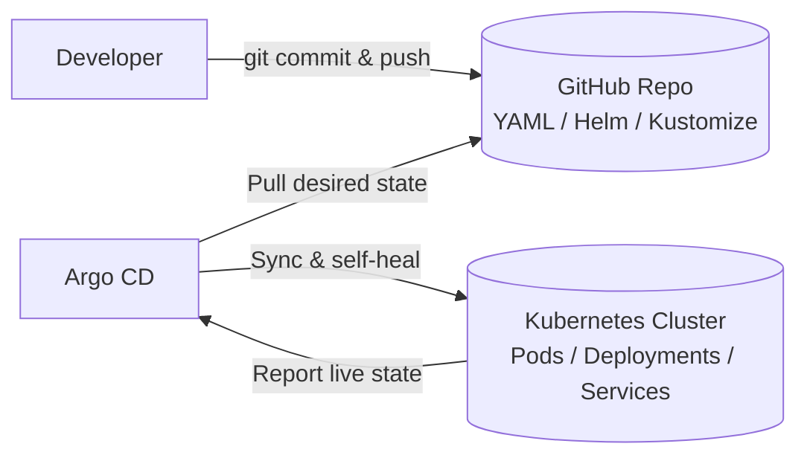

<p align="center">
  
</p>

<h1 align="center">🚀 Argo CD & GitOps Master Guide - From Fundamentals to Production Architecture</h1>

[](https://argo-cd.readthedocs.io/)
[](https://kubernetes.io/)
[](https://helm.sh/)
[](https://kustomize.io/)
[](https://argo-cd.readthedocs.io/)
[](https://github.com/Learning-DevOps-Platform/My-ArgoCD-Lap)

> **Complete GitOps Handbook**: Deep-dive theory, core components, hands-on tutorials, interview questions, and an enterprise-style implementation (**ShopSphere**) using the **App-of-Apps** pattern and **Matrix ApplicationSets**.

---

## 📑 Table of Contents

- [PART I: FUNDAMENTALS & ARCHITECTURE](#part-i-fundamentals--architecture)
  - [1. What is Argo CD?](#1-what-is-argo-cd)
  - [2. Why Use Argo CD? (GitOps vs Traditional CI/CD)](#2-why-use-argo-cd-gitops-vs-traditional-cicd)
  - [3. End-to-End Workflow](#3-end-to-end-workflow)
  - [4. Core Components Deep Dive](#4-core-components-deep-dive)
  - [5. Key GitOps Concepts](#5-key-gitops-concepts)

---

# PART I: FUNDAMENTALS & ARCHITECTURE

## 1. What is Argo CD?

Argo CD is a **declarative, GitOps continuous delivery (CD) tool for Kubernetes**.

It runs as a controller inside the cluster and continuously compares the **desired state** (declared in your Git repository) with the **live state** (running in your Kubernetes cluster). When they differ, it reports the application as `OutOfSync` and, if automated sync is enabled, reconciles the drift.



### The Core GitOps Principles
1. **Source of Truth**: Git holds the complete specification of your application manifests and configuration.
2. **Pull Model**: Argo CD pulls changes from Git into Kubernetes, so external CI systems do not need cluster credentials.
3. **Continuous Reconciliation**: Argo CD detects when the live state drifts from Git (for example, after a manual `kubectl edit`). With `selfHeal` enabled, it reverts the change automatically.

---

## 2. Why Use Argo CD? (GitOps vs Traditional CI/CD)

### Without Argo CD (Traditional Push-based CI/CD)
- External CI runners (Jenkins, GitLab CI, GitHub Actions) need cluster credentials (`kubeconfig`) to deploy.
- If an admin runs `kubectl edit deployment` directly, the cluster drifts from Git and nobody is alerted.
- Rollbacks usually mean re-running a pipeline or manually tracking down an old image tag.

### With Argo CD (GitOps Pull Model)
- **No cluster credentials in CI**: CI only builds and pushes images, then updates the manifests in Git.
- **Drift detection & self-healing**: The live state is compared to Git continuously and can be restored automatically.
- **Auditability**: Every change, deployment, and promotion is recorded in Git history.
- **Simple rollbacks**: Run `git revert <commit-sha>`; with automated sync the cluster follows, otherwise sync manually.
- **Central dashboard**: Live visibility into resources, health, logs, and sync status.

---

## 3. End-to-End Workflow

```
┌──────────────┐       ┌──────────────────────┐       ┌────────────────────────┐
│ 1. Developer │  ==>  │ 2. CI Pipeline       │  ==>  │ 3. Container Registry  │
│ pushes code  │       │ (Build & Run Tests)  │       │ (ghcr.io/app:v2.0)     │
└──────────────┘       └──────────┬───────────┘       └────────────────────────┘
                                  │
                                  ▼ Updates image tag
                       ┌──────────────────────┐
                       │ 4. Deployment Git    │
                       │ Repository (YAML)    │
                       └──────────┬───────────┘
                                  │ Argo CD detects diff
                                  ▼
                       ┌──────────────────────┐       ┌────────────────────────┐
                       │ 5. Argo CD           │  ==>  │ 6. Kubernetes Cluster  │
                       │ (App Controller)     │       │ (Pulls v2.0 image &    │
                       └──────────────────────┘       │ performs rolling sync) │
                                                      └────────────────────────┘
```

> **Key Rule**: CI builds the image. Argo CD only deploys the configuration that references it.

---

## 4. Core Components Deep Dive

| Component | Responsibility | Impact if Down |
| :--- | :--- | :--- |
| **`argocd-server`** (API Server) | Exposes the Web UI, gRPC/REST API, and CLI access; enforces RBAC and handles SSO authentication. | Web UI and CLI become unreachable; running workloads are unaffected. |
| **`argocd-repo-server`** | Clones Git repositories and renders raw Kubernetes YAML using Helm, Kustomize, or plugins. | Argo CD cannot fetch new commits or render manifests, so new changes are not picked up. |
| **`argocd-application-controller`** | Core reconciliation engine. Compares live state with desired state, detects drift, performs syncs, and updates application status. | Automated sync and self-healing stop; existing pods keep running. |
| **`argocd-applicationset-controller`** | Generates `Application` resources from templates and generators (List, Git, Matrix, etc.). | No new Applications are generated or updated from ApplicationSets; existing Applications keep working. |
| **`argocd-redis`** | Cache for repository manifests and cluster state. | Degraded performance; manifests must be regenerated more often. |
| **`argocd-dex-server`** | Identity broker for SSO (GitHub, Google, Okta, OIDC, SAML). | SSO login fails; the local `admin` account still works. |
| **`argocd-notifications-controller`** *(optional)* | Sends notifications (Slack, email, webhooks) on sync and health events. | Notifications stop; deployments are unaffected. |

---
Step 1: Install Prerequisites (Docker, kubectl, Kind)
Kind requires Docker (or a compatible runtime) to be installed and running. You will also need kubectl to interact with the cluster.

Install kubectl (Linux example):

bash
curl -LO "https://dl.k8s.io/release/$(curl -L -s https://dl.k8s.io/release/stable.txt)/bin/linux/amd64/kubectl"
chmod +x ./kubectl
sudo mv ./kubectl /usr/local/bin/kubectl
kubectl version --client

Install Kind (Linux example):

bash
# Download the Kind binary (check the Kind releases page for the latest version if needed)
curl -Lo ./kind https://kind.sigs.k8s.io/dl/v0.24.0/kind-linux-amd64
chmod +x ./kind
sudo mv ./kind /usr/local/bin/kind
kind version

🚀 Step 2: Create a Kind Cluster
Once Kind is installed, create a local Kubernetes cluster. You can give it a specific name for clarity (e.g., argocd-cluster).

bash
kind create cluster --name argocd-cluster

After creation, verify that kubectl is pointing to the correct cluster:

bash
kubectl cluster-info --context kind-argocd-cluster

📦 Step 3: Install Argo CD
Install Argo CD by creating a dedicated namespace and applying the official manifest.

bash
# Create the namespace
kubectl create namespace argocd

# Apply the stable install manifest
kubectl apply -n argocd --server-side --force-conflicts -f https://raw.githubusercontent.com/argoproj/argo-cd/stable/manifests/install.yaml
Note: The --server-side --force-conflicts flags are required because some Argo CD Custom Resource Definitions (CRDs) exceed the size limit for standard client-side apply .

Wait a moment for the pods to start, then verify:

bash
kubectl -n argocd get pods
🔑 Step 4: Access the Argo CD UI
By default, the Argo CD server is not exposed outside the cluster. For local testing, the easiest method is to use port forwarding.

bash
kubectl port-forward svc/argocd-server -n argocd 8080:443

Now you can access the UI in your browser at: https://localhost:8080 (accept the self-signed certificate warning).

Retrieve the initial admin password:

bash
kubectl -n argocd get secret argocd-initial-admin-secret -o jsonpath='{.data.password}' | base64 -d


## 5. Key GitOps Concepts

- **Application CRD**: A Kubernetes Custom Resource that connects a Git source (`repoURL`, `targetRevision`, `path`) to a destination (`server`, `namespace`).
- **Sync Status**:
  - `Synced`: The live state matches the Git manifests.
  - `OutOfSync`: The live state differs from Git.
  - `Unknown`: Argo CD cannot determine the comparison (for example, repo or cluster errors).
- **Health Status**:
  - `Healthy`: Resources are running and passing their health checks.
  - `Progressing`: A rollout or other change is still in progress.
  - `Degraded`: A resource has failed (CrashLoopBackOff, ImagePullBackOff, failing probes).
  - `Suspended`: A resource is paused (for example, a suspended CronJob or paused rollout).
  - `Missing`: A declared resource does not exist in the cluster.
  - `Unknown`: Health could not be assessed.
  - *(Note: An application can be `Synced` but `Degraded` if a broken image or config is deployed.)*
- **Automated Sync** (`syncPolicy.automated`): Argo CD syncs automatically when Git changes. The two options below only apply when this is enabled.
- **Self-Healing (`selfHeal: true`)**: If someone changes a live resource manually (for example, via `kubectl`), Argo CD automatically reverts it to match Git. Default is `false`.
- **Pruning (`prune: true`)**: If a manifest is removed from Git, Argo CD deletes the corresponding resource from the cluster. Default is `false`.

```yaml
syncPolicy:
  automated:
    prune: true
    selfHeal: true
```

---

*GitOps Manual — Maintained for Zero-Downtime Releases and High-Availability Kubernetes Operations.*
