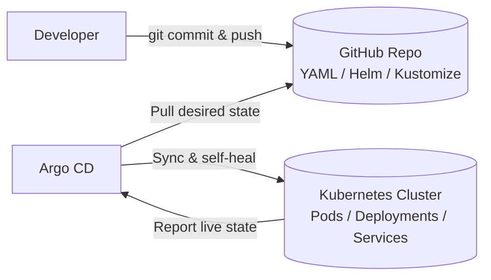

<p align="center">
  
</p>

<h1 align="center">🚀 Argo CD & GitOps Guide: Fundamentals and Local Lab Setup</h1>

[](https://argo-cd.readthedocs.io/)
[](https://kubernetes.io/)
[](https://kind.sigs.k8s.io/)
[](https://github.com/Learning-DevOps-Platform/My-ArgoCD-Lap)

> **GitOps Handbook**: Core theory, Argo CD components, key concepts, and a hands-on local lab using **Kind** (Kubernetes in Docker).

---

## 📑 Table of Contents

- [PART I: Fundamentals & Architecture](#part-i-fundamentals--architecture)
  - [1. What is Argo CD?](#1-what-is-argo-cd)
  - [2. Why Use Argo CD? (GitOps vs Traditional CI/CD)](#2-why-use-argo-cd-gitops-vs-traditional-cicd)
  - [3. End-to-End Workflow](#3-end-to-end-workflow)
  - [4. Core Components Deep Dive](#4-core-components-deep-dive)
  - [5. Key GitOps Concepts](#5-key-gitops-concepts)
- [PART II: Hands-On Lab (Kind + Argo CD)](#part-ii-hands-on-lab-kind--argo-cd)
  - [Step 1: Install Prerequisites](#step-1-install-prerequisites-docker-kubectl-kind)
  - [Step 2: Create a Kind Cluster](#step-2-create-a-kind-cluster)
  - [Step 3: Install Argo CD](#step-3-install-argo-cd)
  - [Step 4: Access the Argo CD UI](#step-4-access-the-argo-cd-ui)
  - [Step 5: Deploy Your First Application](#step-5-deploy-your-first-application)
  - [Step 6: Test GitOps Behavior (Drift, Self-Heal, Rollback)](#step-6-test-gitops-behavior-drift-self-heal-rollback)
  - [Step 7: Clean Up](#step-7-clean-up)
- [Troubleshooting](#troubleshooting)
- [Quick Command Cheat Sheet](#quick-command-cheat-sheet)
- [Further Reading](#further-reading)

---

# PART I: FUNDAMENTALS & ARCHITECTURE

## 1. What is Argo CD?

Argo CD is a **declarative, GitOps continuous delivery (CD) tool for Kubernetes**.

It runs as a controller inside the cluster and continuously compares the **desired state** (declared in your Git repository) with the **live state** (running in your Kubernetes cluster). When they differ, it reports the application as `OutOfSync` and, if automated sync is enabled, reconciles the drift.



### The Core GitOps Principles

1. **Source of Truth**: Git holds the complete specification of your application manifests and configuration.
2. **Pull Model**: Argo CD pulls changes from Git into Kubernetes, so external CI systems do not need cluster credentials.
3. **Continuous Reconciliation**: Argo CD detects when the live state drifts from Git (for example, after a manual `kubectl edit`). With `selfHeal` enabled, it reverts the change automatically.

---

## 2. Why Use Argo CD? (GitOps vs Traditional CI/CD)

### Without Argo CD (Traditional Push-Based CI/CD)

- External CI runners (Jenkins, GitLab CI, GitHub Actions) need cluster credentials (`kubeconfig`) to deploy.
- If an admin runs `kubectl edit deployment` directly, the cluster drifts from Git and nobody is alerted.
- Rollbacks usually mean re-running a pipeline or manually tracking down an old image tag.

### With Argo CD (GitOps Pull Model)

- **No cluster credentials in CI**: CI only builds and pushes images, then updates the manifests in Git.
- **Drift detection & self-healing**: The live state is compared to Git continuously and can be restored automatically.
- **Auditability**: Every change, deployment, and promotion is recorded in Git history.
- **Simple rollbacks**: Run `git revert <commit-sha>`; with automated sync the cluster follows, otherwise sync manually.
- **Central dashboard**: Live visibility into resources, health, logs, and sync status.

### At a Glance

| Aspect | Push-Based CI/CD | GitOps with Argo CD |
| :--- | :--- | :--- |
| Who deploys? | CI runner (`kubectl apply` / `helm upgrade`) | Controller inside the cluster |
| Cluster credentials | Stored in the CI system | Stay inside the cluster |
| Drift detection | None by default | Continuous |
| Rollback | Re-run pipeline / find old tag | `git revert` |
| Audit trail | Pipeline logs | Git history |

---

## 3. End-to-End Workflow

```text
┌──────────────┐       ┌──────────────────────┐       ┌────────────────────────┐
│ 1. Developer │  ==>  │ 2. CI Pipeline       │  ==>  │ 3. Container Registry  │
│ pushes code  │       │ (Build & Run Tests)  │       │ (ghcr.io/app:v2.0)     │
└──────────────┘       └──────────┬───────────┘       └────────────────────────┘
                                  │
                                  ▼ Updates image tag
                       ┌──────────────────────┐
                       │ 4. Deployment Git    │
                       │ Repository (YAML)    │
                       └──────────┬───────────┘
                                  │ Argo CD detects diff
                                  ▼
                       ┌──────────────────────┐       ┌────────────────────────┐
                       │ 5. Argo CD           │  ==>  │ 6. Kubernetes Cluster  │
                       │ (App Controller)     │       │ (Pulls v2.0 image &    │
                       └──────────────────────┘       │ performs rolling sync) │
                                                      └────────────────────────┘
```

> **Key Rule**: CI builds the image. Argo CD only deploys the configuration that references it.

---

## 4. Core Components Deep Dive

| Component | Responsibility | Impact if Down |
| :--- | :--- | :--- |
| **`argocd-server`** (API Server) | Exposes the Web UI, gRPC/REST API, and CLI access; enforces RBAC and handles SSO authentication. | Web UI and CLI become unreachable; running workloads are unaffected. |
| **`argocd-repo-server`** | Clones Git repositories and renders raw Kubernetes YAML using Helm, Kustomize, or plugins. | Argo CD cannot fetch new commits or render manifests, so new changes are not picked up. |
| **`argocd-application-controller`** | Core reconciliation engine. Compares live state with desired state, detects drift, performs syncs, and updates application status. | Automated sync and self-healing stop; existing pods keep running. |
| **`argocd-applicationset-controller`** | Generates `Application` resources from templates and generators (List, Git, Matrix, etc.). | No new Applications are generated or updated from ApplicationSets; existing Applications keep working. |
| **`argocd-redis`** | Cache for repository manifests and cluster state. | Degraded performance; manifests must be regenerated more often. |
| **`argocd-dex-server`** | Identity broker for SSO (GitHub, Google, Okta, OIDC, SAML). | SSO login fails; the local `admin` account still works. |
| **`argocd-notifications-controller`** *(optional)* | Sends notifications (Slack, email, webhooks) on sync and health events. | Notifications stop; deployments are unaffected. |

---

## 5. Key GitOps Concepts

- **Application CRD**: A Kubernetes Custom Resource that connects a Git source (`repoURL`, `targetRevision`, `path`) to a destination (`server`, `namespace`).
- **Sync Status**:
  - `Synced`: The live state matches the Git manifests.
  - `OutOfSync`: The live state differs from Git.
  - `Unknown`: Argo CD cannot determine the comparison (for example, repo or cluster errors).
- **Health Status**:
  - `Healthy`: Resources are running and passing their health checks.
  - `Progressing`: A rollout or other change is still in progress.
  - `Degraded`: A resource has failed (CrashLoopBackOff, ImagePullBackOff, failing probes).
  - `Suspended`: A resource is paused (for example, a suspended CronJob or paused rollout).
  - `Missing`: A declared resource does not exist in the cluster.
  - `Unknown`: Health could not be assessed.
  - *(Note: An application can be `Synced` but `Degraded` if a broken image or config is deployed.)*
- **Automated Sync** (`syncPolicy.automated`): Argo CD syncs automatically when Git changes. The two options below only apply when this is enabled.
- **Self-Healing** (`selfHeal: true`): If someone changes a live resource manually (for example, via `kubectl`), Argo CD automatically reverts it to match Git. Default is `false`.
- **Pruning** (`prune: true`): If a manifest is removed from Git, Argo CD deletes the corresponding resource from the cluster. Default is `false`.
- **Project (`AppProject`)**: A logical grouping that restricts which repos, clusters, and namespaces an Application may use. Every Application belongs to one; the built-in one is `default`.

```yaml
syncPolicy:
  automated:
    prune: true
    selfHeal: true
```

---

# PART II: HANDS-ON LAB (KIND + ARGO CD)

This lab creates a local Kubernetes cluster with **Kind**, installs Argo CD, opens the UI, deploys a sample app, and proves drift detection and self-healing.

## Step 1: Install Prerequisites (Docker, kubectl, Kind)

Kind requires Docker (or a compatible container runtime) to be installed and running. You also need `kubectl` to interact with the cluster.

Verify Docker is running:

```bash
docker version
```

**Install kubectl (Linux amd64 example):**

```bash
curl -LO "https://dl.k8s.io/release/$(curl -L -s https://dl.k8s.io/release/stable.txt)/bin/linux/amd64/kubectl"
chmod +x ./kubectl
sudo mv ./kubectl /usr/local/bin/kubectl
kubectl version --client
```

**Install Kind (Linux amd64 example):**

```bash
# Check https://github.com/kubernetes-sigs/kind/releases for the latest version
KIND_VERSION=v0.24.0
curl -Lo ./kind "https://kind.sigs.k8s.io/dl/${KIND_VERSION}/kind-linux-amd64"
chmod +x ./kind
sudo mv ./kind /usr/local/bin/kind
kind version
```

> **Note**: On ARM64 machines, replace `amd64` with `arm64` in both downloads. On macOS, you can use `brew install kubectl kind`. On Windows, use `choco install kubernetes-cli kind` or download the binaries from the release pages.

---

## Step 2: Create a Kind Cluster

Create a local Kubernetes cluster with a descriptive name:

```bash
kind create cluster --name my-cluster
```

Verify that `kubectl` points to the new cluster:

```bash
kubectl cluster-info --context kind-my-cluster
kubectl get nodes
```

You should see one node in `Ready` state.

---

## Step 3: Install Argo CD

Create a dedicated namespace and apply the official stable manifest:

```bash
# Create the namespace
kubectl create namespace argocd

# Apply the stable install manifest
kubectl apply -n argocd --server-side --force-conflicts \
  -f https://raw.githubusercontent.com/argoproj/argo-cd/stable/manifests/install.yaml
```

> **Note**: The `--server-side --force-conflicts` flags are required because some Argo CD Custom Resource Definitions (CRDs) exceed the size limit for standard client-side apply.

Wait for the pods to become ready, then verify:

```bash
kubectl -n argocd wait --for=condition=Ready pods --all --timeout=300s
kubectl -n argocd get pods
```

Expected pods (names will have suffixes):

```text
argocd-application-controller-0
argocd-applicationset-controller-...
argocd-dex-server-...
argocd-notifications-controller-...
argocd-redis-...
argocd-repo-server-...
argocd-server-...
```

---

## Step 4: Access the Argo CD UI

By default, the Argo CD server is not exposed outside the cluster. For local testing, the easiest method is port forwarding. This command keeps running, so **use a separate terminal** for it:

```bash
kubectl port-forward svc/argocd-server -n argocd 8080:443
```

Open **https://localhost:8080** in your browser (accept the self-signed certificate warning).

**Log in** with username `admin` and the initial password, retrieved with:

```bash
kubectl -n argocd get secret argocd-initial-admin-secret \
  -o jsonpath='{.data.password}' | base64 -d; echo
```

> **Tip**: After changing the admin password (User Info → Update Password), delete the initial secret:
> `kubectl -n argocd delete secret argocd-initial-admin-secret`

*(Optional)* **Install the Argo CD CLI** to manage apps from the terminal:

```bash
# macOS
brew install argocd

# Linux
curl -sSL -o argocd https://github.com/argoproj/argo-cd/releases/latest/download/argocd-linux-amd64
chmod +x argocd && sudo mv argocd /usr/local/bin/argocd

# Log in (uses the port-forward from above)
argocd login localhost:8080 --username admin --insecure
```

---

## Step 5: Deploy Your First Application

We will deploy the official **guestbook** sample from the `argoproj/argocd-example-apps` repository. You can do this declaratively (recommended, GitOps style), through the UI, or with the CLI.

### Option A: Declarative (recommended)

Save the following as `guestbook-app.yaml`:

```yaml
apiVersion: argoproj.io/v1alpha1
kind: Application
metadata:
  name: guestbook
  namespace: argocd
spec:
  project: default
  source:
    repoURL: https://github.com/argoproj/argocd-example-apps.git
    targetRevision: HEAD
    path: guestbook
  destination:
    server: https://kubernetes.default.svc   # the cluster Argo CD runs in
    namespace: guestbook
  syncPolicy:
    automated:
      prune: true
      selfHeal: true
    syncOptions:
      - CreateNamespace=true
```

Apply it:

```bash
kubectl apply -f guestbook-app.yaml
```

### Option B: Argo CD UI

1. Click **+ NEW APP**.
2. Fill in:
   - **Application Name**: `guestbook`
   - **Project**: `default`
   - **Sync Policy**: `Automatic` (tick *Prune Resources* and *Self Heal*)
   - **Sync Options**: tick *Auto-Create Namespace*
   - **Repository URL**: `https://github.com/argoproj/argocd-example-apps.git`
   - **Revision**: `HEAD`
   - **Path**: `guestbook`
   - **Cluster URL**: `https://kubernetes.default.svc`
   - **Namespace**: `guestbook`
3. Click **CREATE**.

### Option C: Argo CD CLI

```bash
argocd app create guestbook \
  --repo https://github.com/argoproj/argocd-example-apps.git \
  --path guestbook \
  --dest-server https://kubernetes.default.svc \
  --dest-namespace guestbook \
  --sync-policy automated --auto-prune --self-heal \
  --sync-option CreateNamespace=true
```

### Verify the deployment

```bash
kubectl get applications -n argocd        # SYNC STATUS: Synced, HEALTH STATUS: Healthy
kubectl get all -n guestbook
```

Open the app in the UI to see the resource tree (Deployment → ReplicaSet → Pod, plus the Service).

To view the running guestbook itself:

```bash
kubectl port-forward svc/guestbook-ui -n guestbook 8081:80
```

Then open **http://localhost:8081**.

---

## Step 6: Test GitOps Behavior (Drift, Self-Heal, Rollback)

### 6.1 Drift detection and self-healing

The guestbook Deployment declares **1 replica** in Git. Change it manually:

```bash
kubectl scale deployment guestbook-ui -n guestbook --replicas=3
kubectl get pods -n guestbook -w
```

Because `selfHeal: true` is enabled, Argo CD notices the difference and scales the Deployment back to **1 replica** within moments. Watch the same thing happen in the UI (`OutOfSync` → `Synced`).

> **Want to see `OutOfSync`?** Set `selfHeal: false` (or disable automated sync) and repeat the scale command. The app will stay `OutOfSync` until you click **SYNC**.

### 6.2 Pruning

With `prune: true`, deleting a manifest from Git removes the resource from the cluster. To try this, **fork** `argocd-example-apps`, point your Application at your fork, delete a manifest (for example `guestbook/guestbook-ui-svc.yaml`), push, and watch Argo CD delete the Service.

### 6.3 Rollback

Because your fork is the source of truth, rolling back is a Git operation:

```bash
git revert <commit-sha>
git push
```

Argo CD syncs to the reverted state. You can also use **History and Rollback** in the UI for an emergency rollback (note that rollback is not available while automated sync is enabled; disable it first).

---

## Step 7: Clean Up

Delete the application first (so Argo CD removes the resources it created), then the cluster:

```bash
kubectl delete -f guestbook-app.yaml
# or: argocd app delete guestbook --cascade
```

> **Tip**: To delete the managed resources along with the Application, the Application needs the `resources-finalizer.argocd.argoproj.io` finalizer (the CLI and UI add it for you with cascade delete). Without it, deleting the Application leaves the deployed resources behind.

Remove the whole lab environment:

```bash
kind delete cluster --name my-cluster
```

---

# Troubleshooting

| Symptom | Likely Cause | Fix |
| :--- | :--- | :--- |
| `kind create cluster` fails | Docker is not running | Start Docker, then run `docker ps` to confirm |
| CRD error on install (`metadata.annotations: Too long`) | Client-side apply used | Re-run with `--server-side --force-conflicts` |
| `localhost:8080` not loading | Port-forward stopped or port in use | Restart the port-forward or use another local port (e.g. `8082:443`) |
| `argocd-initial-admin-secret` not found | Secret was already deleted after a password change | Reset via `argocd account update-password` or patch the `argocd-secret` |
| App stuck `OutOfSync` | Automated sync disabled, or sync failed | Click **SYNC**, check the **Events** and **Sync Result** tabs |
| App `Synced` but `Degraded` | Bad image / failing probe | `kubectl describe pod -n <ns> <pod>` and `kubectl logs` |
| `ComparisonError` / repo not found | Wrong `repoURL`, private repo without credentials | Fix the URL or add repo credentials in **Settings → Repositories** |
| Namespace not found on sync | `CreateNamespace=true` missing | Add the sync option or create the namespace manually |
| Pods `Pending` after install | Docker has too little CPU/memory | Increase Docker resources (4 GB RAM recommended) |

Useful debugging commands:

```bash
kubectl -n argocd logs deploy/argocd-repo-server
kubectl -n argocd logs statefulset/argocd-application-controller
kubectl -n argocd describe application guestbook
```

---

# Quick Command Cheat Sheet

```bash
# Cluster
kind create cluster --name my-cluster
kind get clusters
kind delete cluster --name my-cluster

# Argo CD access
kubectl port-forward svc/argocd-server -n argocd 8080:443
kubectl -n argocd get secret argocd-initial-admin-secret -o jsonpath='{.data.password}' | base64 -d; echo

# Applications
kubectl get applications -n argocd
argocd app list
argocd app get guestbook
argocd app sync guestbook
argocd app history guestbook
argocd app rollback guestbook <ID>
argocd app delete guestbook --cascade
```

---

# Further Reading

- [Argo CD Documentation](https://argo-cd.readthedocs.io/)
- [Argo CD Example Apps](https://github.com/argoproj/argocd-example-apps)
- [Kind Documentation](https://kind.sigs.k8s.io/)
- [OpenGitOps Principles](https://opengitops.dev/)

---

*GitOps Guide: a hands-on reference for learning declarative, Git-driven Kubernetes delivery.*
