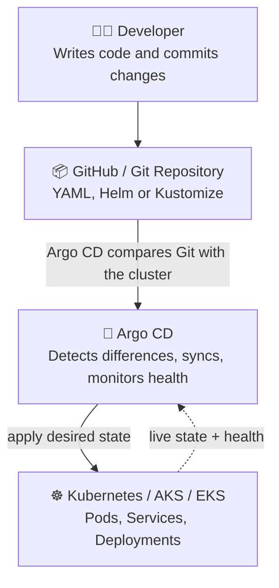
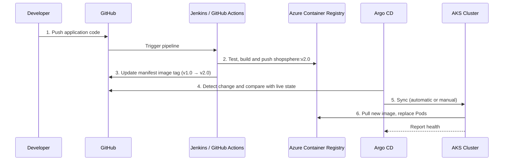

# 🚀 Argo CD — Complete Guide from Beginner to Advanced

> **GitOps made simple.** Learn how Argo CD keeps your Kubernetes clusters in sync with Git, with a hands-on, real-world example (**ShopSphere** on AKS), troubleshooting tables, production best practices, and interview prep.

---

## 📑 Table of Contents

1. [What is Argo CD?](#1-what-is-argo-cd)
2. [Argo CD Architecture](#2-argo-cd-architecture)
3. [Why Do We Need Argo CD?](#3-why-do-we-need-argo-cd)
4. [Argo CD vs Jenkins vs Kubernetes (and Friends)](#4-argo-cd-vs-jenkins-vs-kubernetes-and-friends)
5. [How Argo CD Works End to End](#5-how-argo-cd-works-end-to-end)
6. [Argo CD Core Components](#6-argo-cd-core-components)
7. [Important Argo CD Concepts](#7-important-argo-cd-concepts)
8. [Install Argo CD on Kubernetes](#8-install-argo-cd-on-kubernetes)
9. [Connect GitHub to Argo CD](#9-connect-github-to-argo-cd)
10. [Create an Argo CD Application](#10-create-an-argo-cd-application)
11. [Manual Sync vs Automatic Sync](#11-manual-sync-vs-automatic-sync)
12. [What Happens If Someone Changes Kubernetes Manually?](#12-what-happens-if-someone-changes-kubernetes-manually)
13. [How Do You Roll Back a Deployment?](#13-how-do-you-roll-back-a-deployment)
14. [Common Errors and Troubleshooting](#14-common-errors-and-troubleshooting)
15. [Production Best Practices](#15-production-best-practices)
16. [Interview Questions](#16-interview-questions)
17. [Recommended Learning Path](#17-recommended-learning-path)
18. [Key Takeaway](#18-key-takeaway)

---

## 1. What is Argo CD?

**Argo CD** is a **GitOps continuous delivery (CD) tool for Kubernetes**. It automatically deploys applications to Kubernetes clusters based on the configuration stored in a Git repository, and it continuously checks whether the **actual cluster state** matches the **desired state**.

If you're learning DevOps or Cloud Engineering, Argo CD is an important tool to understand alongside **Kubernetes, Docker, Jenkins, Helm, and Terraform**.

### 🛍️ A Real-World Example: ShopSphere

Imagine you have an application called **ShopSphere**.

- You develop the application and build a Docker image.
- You push the image to a container registry.
- You store Kubernetes deployment manifests in GitHub.
- Argo CD detects the configuration changes in Git.
- Argo CD deploys the desired configuration to your Kubernetes cluster.
- Argo CD monitors the cluster and reports whether it matches Git.

This process is called **GitOps**.

> 💡 **In simple terms:** Git is the source of truth, and Argo CD keeps Kubernetes aligned with what Git declares.

---

## 2. Argo CD Architecture

```text
┌──────────────────────────────┐
│          Developer           │
│ Writes code and commits      │
└──────────────┬───────────────┘
               │ git push
               ▼
┌──────────────────────────────┐
│   GitHub / Git Repository    │
│ Kubernetes YAML, Helm charts │
│ or Kustomize                 │
└──────────────┬───────────────┘
               │ Argo CD compares Git with the cluster
               ▼
┌──────────────────────────────┐
│           Argo CD            │
│ Detects differences, syncs   │
│ resources, monitors health   │
└──────────────┬───────────────┘
               │ apply
               ▼
┌──────────────────────────────┐
│   Kubernetes / AKS / EKS     │
│ Runs Pods, Services and      │
│ Deployments                  │
└──────────────────────────────┘
```



**The key idea:** Argo CD reads the desired application configuration from Git and compares it with the live Kubernetes resources. Depending on the application's **sync policy**, it can apply the changes **automatically** or **wait for you to sync them**.

---

## 3. Why Do We Need Argo CD?

Without Argo CD, a DevOps engineer might manually run deployment commands or configure a Jenkins pipeline to apply Kubernetes YAML files.

For example:

```bash
kubectl apply -f deployment.yaml
kubectl apply -f service.yaml
```

This can work, but it becomes **difficult to manage many applications and clusters consistently**.

### ✅ With Argo CD

- Deployment configuration is **version-controlled in Git**.
- Changes can be **deployed automatically**.
- You can see **deployment status in a dashboard**.
- You can **identify differences** between Git and Kubernetes.
- You can **roll back by reverting Git changes**.
- You can **manage multiple applications and clusters centrally**.

> ℹ️ Argo CD does **not** replace Kubernetes. It manages the **delivery and synchronization** of Kubernetes resources.

---

## 4. Argo CD vs Jenkins vs Kubernetes (and Friends)

| Tool | Main responsibility |
|------|---------------------|
| **Docker** | Packages an application into a container image |
| **Jenkins** | Automates CI tasks such as testing and building images |
| **GitHub** | Stores source code and deployment configuration |
| **Argo CD** | Synchronizes Git configuration with Kubernetes |
| **Kubernetes** | Runs and manages containerized applications |
| **Helm** | Packages and templates Kubernetes resources |
| **Terraform** | Provisions infrastructure such as networks and clusters |

A common DevOps setup uses **Jenkins for CI** and **Argo CD for CD**. Other CI tools, such as **GitHub Actions**, can perform the same build-and-test role.

---

## 5. How Argo CD Works End to End

Let's use **ShopSphere** as a real-world example running on **Azure Kubernetes Service (AKS)**.

### Step 1 — Developer pushes code

The developer commits application code and pushes it to GitHub.

*Example: a new feature for the ShopSphere application.*

### Step 2 — CI pipeline builds the image

Jenkins or GitHub Actions runs tests, builds the Docker image and pushes it to **Azure Container Registry (ACR)**.

*Example: `shopsphere:v2.0`*

### Step 3 — Update the deployment repository

The pipeline or a developer updates the Kubernetes manifest with the new image tag and commits it to Git.

*Example: `shopsphere:v1.0` → `shopsphere:v2.0`*

### Step 4 — Argo CD detects the Git change

Argo CD refreshes the repository state and compares the desired configuration against the live resources in AKS.

### Step 5 — Argo CD synchronizes the application

If **automatic sync** is enabled, Argo CD applies the required Kubernetes changes. Otherwise, an authorized operator can trigger a **manual sync**.

### Step 6 — Kubernetes runs the new version

Kubernetes pulls the new image, replaces Pods according to the Deployment strategy and reports workload health. Argo CD displays the **sync** and **health** status.



> 📌 This is the typical GitOps deployment flow. **Argo CD synchronizes Kubernetes configuration; the CI pipeline builds the image.**

---

## 6. Argo CD Core Components

These are the main internal components you should know for interviews.

| Component | What it does |
|-----------|--------------|
| **API Server** | Provides the UI, CLI/API access, authentication and application operations |
| **Repository Server** | Retrieves Git content and renders manifests from YAML, Helm or Kustomize |
| **Application Controller** | Compares desired and live states, manages synchronization and monitors resource health |
| **Redis** | Caches application and repository-related data to support efficient operation |
| **Dex / identity integration** | Can support authentication through external identity providers, depending on configuration |

> 🧠 The **API server**, **repository server** and **application controller** are the main components to remember first.

---

## 7. Important Argo CD Concepts

### Application
An Argo CD resource that defines **what to deploy**: the Git source, target cluster, namespace and synchronization policy.

### Git Repository
Stores the **desired deployment configuration**, such as Kubernetes manifests, Helm charts or Kustomize files.

### Sync Status

| Status | Meaning |
|--------|---------|
| ✅ **Synced** | The desired configuration matches the live configuration for the tracked resources |
| ⚠️ **OutOfSync** | A difference exists between the desired and live states |

### Health Status
Shows whether application resources are healthy. An application can be **Synced but still Degraded** if a workload is unhealthy.

### Self-Healing
With automated sync and self-heal enabled, Argo CD can correct certain live-cluster changes that differ from Git.

### Pruning
Deletes resources managed by the application when they are **no longer declared in Git**, if pruning is enabled or explicitly selected for a sync.

---

## 8. Install Argo CD on Kubernetes

You can install Argo CD on a Kubernetes cluster such as **Minikube, AKS or EKS**. For learning, Minikube or an existing test cluster is a good starting point.

### Step 1 — Create the namespace

```bash
kubectl create namespace argocd
```

### Step 2 — Install Argo CD

```bash
kubectl apply -n argocd --server-side --force-conflicts \
  -f https://raw.githubusercontent.com/argoproj/argo-cd/stable/manifests/install.yaml
```

This installs Argo CD's core resources into the `argocd` namespace.

### Step 3 — Verify the installation

```bash
kubectl get pods -n argocd
kubectl get svc -n argocd
kubectl get deployments -n argocd
```

Wait until the required Pods are **running and ready**.

### Step 4 — Access the Argo CD web UI

For a typical installation, forward the API server service to your local machine:

```bash
kubectl port-forward svc/argocd-server -n argocd 8080:443
```

Open:

```text
https://localhost:8080
```

> ⚠️ Your browser may show a certificate warning when using the default self-signed certificate. For a local learning environment, verify that you're accessing your own cluster before proceeding.

### Step 5 — Retrieve the initial admin password

```bash
kubectl -n argocd get secret argocd-initial-admin-secret \
  -o jsonpath="{.data.password}" | base64 -d
```

The initial username is generally **`admin`**. Log in and **change or replace the initial credentials** according to your environment's security practices.

> 🔐 Avoid using default administrative access in production.

---

## 9. Connect GitHub to Argo CD

You need a Git repository containing Kubernetes deployment configuration.

For example, your repository could have this structure:

```text
shopsphere-gitops/
├── deployment.yaml
├── service.yaml
└── namespace.yaml
```

You can use a **private or public** Git repository. For private repositories, configure appropriate repository credentials or an authorized integration.

### Example `deployment.yaml`

This is a simplified example of a Kubernetes Deployment:

```yaml
apiVersion: apps/v1
kind: Deployment
metadata:
  name: shopsphere
  namespace: default
spec:
  replicas: 2
  selector:
    matchLabels:
      app: shopsphere
  template:
    metadata:
      labels:
        app: shopsphere
    spec:
      containers:
        - name: shopsphere
          image: nginx:1.27
          ports:
            - containerPort: 80
```

> This example uses **NGINX** as a demonstration image. In a real project, you would use your application's image from **ACR, ECR, Docker Hub** or another registry.

Commit and push the file to your Git repository.

---

## 10. Create an Argo CD Application

An Argo CD **Application** tells Argo CD which repository to monitor and where to deploy the resources.

Create a file named `application.yaml`:

```yaml
apiVersion: argoproj.io/v1alpha1
kind: Application
metadata:
  name: shopsphere
  namespace: argocd
spec:
  project: default

  source:
    repoURL: https://github.com/YOUR-ORG/shopsphere-gitops.git
    targetRevision: main
    path: .

  destination:
    server: https://kubernetes.default.svc
    namespace: default

  syncPolicy:
    automated:
      prune: false
      selfHeal: true
```

Replace `YOUR-ORG` with your GitHub organization or username and ensure the repository contains the manifests in the specified path.

Apply it:

```bash
kubectl apply -f application.yaml
```

Check the application:

```bash
kubectl get applications -n argocd
```

If the repository and cluster configuration are correct, Argo CD can now reconcile the application. **Automated sync is enabled** in this example, while **pruning is deliberately disabled**.

> ⚠️ **Important:** For a real deployment, pin a suitable application image version rather than relying on a mutable tag, and configure registry access, resource limits, secrets and health probes appropriately.

---

## 11. Manual Sync vs Automatic Sync

### 🖐️ Manual Synchronization (operator controlled)

1. A developer changes Git.
2. Argo CD detects that the application is **OutOfSync**.
3. An authorized operator clicks **Sync** in the UI or runs a sync command.
4. Argo CD applies the desired resources.

### 🤖 Automatic Synchronization (configured automation)

1. A developer changes Git.
2. Argo CD detects the new desired state.
3. Argo CD synchronizes the resources automatically.
4. Argo CD continues to monitor application state.

### Useful commands

```bash
argocd app list
argocd app get shopsphere
argocd app sync shopsphere
argocd app history shopsphere
```

> These commands require the **Argo CD CLI** to be installed and authenticated to your Argo CD server.

> 🏭 For production, choose the sync policy carefully. **Automatic sync, self-heal and pruning are separate controls**; enable destructive operations only when their effects are understood.

---

## 12. What Happens If Someone Changes Kubernetes Manually?

Suppose Git declares:

```yaml
replicas: 2
```

But an engineer runs:

```bash
kubectl scale deployment shopsphere --replicas=5
```

The cluster now has a different replica count from the Git configuration.

| Source | State |
|--------|-------|
| **Desired state in Git** | 2 replicas |
| **Live state in Kubernetes** | 5 replicas |

Argo CD detects the difference and reports the application as **OutOfSync**.

If **automated sync and self-heal** are configured, Argo CD can restore the declared configuration of **2 replicas**.

> 🎯 This is called **configuration drift**. It is one of the main problems GitOps is designed to address.

---

## 13. How Do You Roll Back a Deployment?

A GitOps rollback normally means **reverting the deployment configuration to a previous known-good version**.

For example:

1. Version `v1.0` works correctly.
2. Git is updated to deploy `v2.0`.
3. The new version causes an issue.
4. You revert the Git commit to the configuration for `v1.0`.
5. Argo CD synchronizes the reverted configuration.

```bash
git revert <commit-id>
git push origin main
```

With automatic sync enabled, Argo CD can deploy the reverted configuration automatically.

> ⚠️ **Remember:** reverting the manifest is not always enough. The previous container image must still be available, and database changes or other irreversible operations may require a separate recovery plan.

---

## 14. Common Errors and Troubleshooting

| Problem | What to check |
|---------|---------------|
| **OutOfSync** | Compare the Git manifest with the live resource and review sync policy |
| **SyncFailed** | Check the sync operation details, Kubernetes events and resource permissions |
| **ComparisonError** | Check Git access, repository URL, manifest rendering and Helm/Kustomize errors |
| **ImagePullBackOff** | Verify image name, tag, registry credentials and cluster network access |
| **Degraded** | Inspect Pod status, application logs, health probes and Kubernetes events |
| **Repository connection failure** | Verify credentials, branch, repository path and network connectivity |

### Useful commands

```bash
kubectl get pods -n argocd
kubectl logs -n argocd deployment/argocd-application-controller
kubectl get events -A --sort-by=.lastTimestamp
kubectl describe deployment shopsphere
kubectl logs deployment/shopsphere
```

> Adjust the resource names and namespaces to match your setup.

---

## 15. Production Best Practices

For a production DevOps environment, focus on these practices:

- 🔍 **Git review:** Require pull requests and approvals for production changes.
- 🔑 **Access control:** Apply least-privilege RBAC and secure repository credentials.
- 🧱 **Environment separation:** Keep development, staging and production configurations appropriately separated.
- 🤫 **Secrets management:** Avoid committing plaintext credentials to Git; use an appropriate secrets-management solution.
- 🛡️ **Image security:** Scan images and use controlled, traceable image versions.
- 📈 **Monitoring:** Monitor Argo CD, Kubernetes workload health and deployment failures.
- ✂️ **Pruning protection:** Understand what deleting a resource from Git will do before enabling automatic pruning.
- 🏗️ **High availability:** Plan the Argo CD deployment and recovery process according to production requirements.

---

## 16. Interview Questions

### 1. What is Argo CD?
Argo CD is a **declarative GitOps continuous delivery tool for Kubernetes**. It compares the desired state in Git with live cluster resources and supports manual or automated synchronization.

### 2. What is the difference between Synced and Healthy?
**Synced** describes whether tracked resources match the desired configuration. **Healthy** describes the operational health of the resources. An application can be **Synced but Degraded**.

### 3. Does Argo CD build Docker images?
**No.** Argo CD is a CD tool, not a CI tool. Image building and testing are done by a CI system such as Jenkins or GitHub Actions. Argo CD deploys the Kubernetes configuration that references the image the CI pipeline produced.

### 4. What is self-healing?
Self-healing is an automated sync option. When enabled, Argo CD detects certain manual changes made directly in the cluster (for example, a `kubectl scale` command) and **restores the live resources to the state declared in Git**.

### 5. What is pruning?
Pruning means Argo CD **deletes resources from the cluster that are no longer declared in Git**. It is controlled separately from automated sync, so it should only be enabled when you understand what removing a manifest from Git will delete.

### 6. How does Argo CD differ from Jenkins?
**Jenkins** is mainly a **CI** tool: it runs tests and builds and pushes images (and can also run deployment scripts). **Argo CD** is a **GitOps CD** tool: it continuously compares Git with the cluster, reports drift and health, and synchronizes Kubernetes resources. They are commonly used together — Jenkins for CI, Argo CD for CD.

### 7. Can Argo CD manage multiple clusters?
**Yes.** A single Argo CD instance can manage applications across multiple clusters by registering additional clusters and setting each Application's `destination` to the target cluster. This allows centralized management of many applications and environments.

---

## 17. Recommended Learning Path

1. Learn **Kubernetes fundamentals**: Pods, Deployments, Services, ConfigMaps and Namespaces.
2. Understand **Git and Kubernetes YAML manifests**.
3. **Install Argo CD** on a local Kubernetes cluster.
4. **Connect GitHub** and deploy a sample application.
5. Practise **automatic sync, self-healing and safe rollback**.
6. Deploy an application to **AKS using ACR, Helm and Argo CD**.
7. Build a **CI/CD pipeline** using Jenkins or GitHub Actions with GitOps delivery.

For official learning material, start with the **Argo CD documentation** and its **Getting Started** guide.

---

## 18. Key Takeaway

> **CI builds and tests the application; Git stores the desired deployment configuration; Argo CD reconciles that configuration with Kubernetes; and Kubernetes runs the application.**

---

⭐ If this guide helped you, consider starring the repository and sharing it with fellow DevOps learners!
