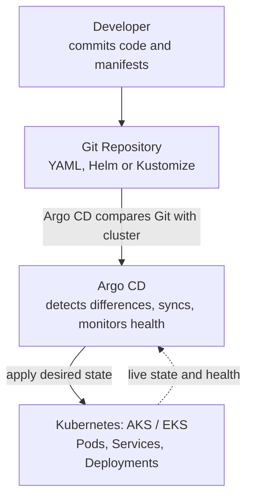
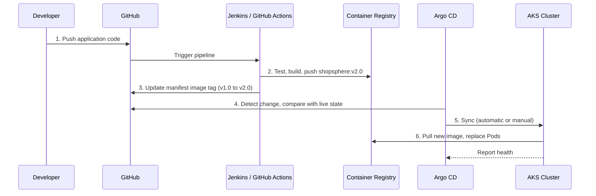

<p align="center">
  
</p>

<h1 align="center">Argo CD: Beginner to Advanced Guide</h1>

Argo CD keeps Kubernetes clusters in sync with Git, using a hands-on $ troubleshooting tips, best practices.

## Table of Contents

1. [What is Argo CD?](#1-what-is-argo-cd)
2. [Architecture](#2-architecture)
3. [Why Use Argo CD?](#3-why-use-argo-cd)
4. [Argo CD vs Other Tools](#4-argo-cd-vs-other-tools)
5. [How It Works End to End](#5-how-it-works-end-to-end)
6. [Core Components](#6-core-components)
7. [Key Concepts](#7-key-concepts)
8. [Install Argo CD](#8-install-argo-cd)
9. [Prepare the Git Repository](#9-prepare-the-git-repository)
10. [Create an Application](#10-create-an-application)
11. [Manual vs Automatic Sync](#11-manual-vs-automatic-sync)
12. [Configuration Drift](#12-configuration-drift)
13. [Rollback](#13-rollback)
14. [Troubleshooting](#14-troubleshooting)
15. [Production Best Practices](#15-production-best-practices)
16. [Interview Questions](#16-interview-questions)
17. [Learning Path](#17-learning-path)

---

## 1. What is Argo CD?

Argo CD is a **GitOps continuous delivery (CD) tool for Kubernetes**. It deploys applications to a cluster based on configuration stored in Git, and continuously checks that the **live state** of the cluster matches the **desired state** in Git.

**Example (ShopSphere):**

1. You build a Docker image and push it to a container registry.
2. Kubernetes manifests are stored in GitHub.
3. Argo CD detects changes in Git and applies them to the cluster.
4. Argo CD reports whether the cluster matches Git.

> **In short:** Git is the source of truth, and Argo CD keeps Kubernetes aligned with it.

---

## 2. Architecture



Argo CD reads the desired configuration from Git and compares it with live Kubernetes resources. Depending on the **sync policy**, it applies changes automatically or waits for a manual sync.

---

## 3. Why Use Argo CD?

Without Argo CD, deployments are often done manually or through a pipeline:

```bash
kubectl apply -f deployment.yaml
kubectl apply -f service.yaml
```

This becomes hard to manage across many applications and clusters.

**With Argo CD:**

- Deployment configuration is version-controlled in Git.
- Changes can be deployed automatically.
- A dashboard shows deployment status.
- Differences between Git and the cluster are visible.
- Rollback is done by reverting a Git commit.
- Multiple applications and clusters can be managed centrally.

> Argo CD does not replace Kubernetes. It manages the delivery and synchronization of Kubernetes resources.

---

## 4. Argo CD vs Other Tools

| Tool | Main responsibility |
|------|---------------------|
| Docker | Packages an application into a container image |
| Jenkins / GitHub Actions | CI: runs tests and builds images |
| GitHub | Stores source code and deployment configuration |
| Argo CD | Synchronizes Git configuration with Kubernetes |
| Kubernetes | Runs and manages containerized applications |
| Helm | Packages and templates Kubernetes resources |
| Terraform | Provisions infrastructure (networks, clusters) |

A common setup: **Jenkins or GitHub Actions for CI, Argo CD for CD.**

---

## 5. How It Works End to End



1. **Push code:** a developer pushes a change to GitHub.
2. **Build image:** CI runs tests, builds the image and pushes it to the registry (for example `shopsphere:v2.0`).
3. **Update manifests:** the pipeline or a developer updates the image tag in the deployment repository.
4. **Detect change:** Argo CD compares Git with the live cluster.
5. **Sync:** with automatic sync, Argo CD applies the change; otherwise an operator syncs manually.
6. **Run:** Kubernetes pulls the new image and replaces Pods. Argo CD shows sync and health status.

> CI builds the image. Argo CD only deploys the configuration that references it.

---

## 6. Core Components

| Component | What it does |
|-----------|--------------|
| **API Server** | Provides the UI, CLI/API access, authentication and application operations |
| **Repository Server** | Fetches Git content and renders manifests (YAML, Helm, Kustomize) |
| **Application Controller** | Compares desired and live state, performs sync, monitors health |
| **Redis** | Caches application and repository data |
| **Dex** | Optional integration with external identity providers |

The first three are the most important to remember.

---

## 7. Key Concepts

- **Application:** an Argo CD resource that defines what to deploy: Git source, target cluster, namespace and sync policy.
- **Sync status:**
  - `Synced`: live state matches Git.
  - `OutOfSync`: live state differs from Git.
- **Health status:** whether resources are working. An app can be **Synced but Degraded**.
- **Self-healing:** with automated sync and self-heal enabled, Argo CD reverts manual cluster changes back to the Git state.
- **Pruning:** deletes resources that are no longer declared in Git (only if enabled).

---

## 8. Install Argo CD

Works on Minikube, AKS, EKS or any Kubernetes cluster.

**1. Create the namespace**

```bash
kubectl create namespace argocd
```

**2. Install Argo CD**

```bash
kubectl apply -n argocd --server-side --force-conflicts \
  -f https://raw.githubusercontent.com/argoproj/argo-cd/stable/manifests/install.yaml
```

**3. Verify**

```bash
kubectl get pods -n argocd
```

Wait until all Pods are `Running` and ready.

**4. Access the UI**

```bash
kubectl port-forward svc/argocd-server -n argocd 8080:443
```

Open `https://localhost:8080`. The browser may warn about the self-signed certificate; this is expected in a local setup.

**5. Get the initial admin password**

```bash
kubectl -n argocd get secret argocd-initial-admin-secret \
  -o jsonpath="{.data.password}" | base64 -d
```

Log in with username `admin`, then change the password. Avoid default admin access in production.

---

## 9. Prepare the Git Repository

Create a repository with your Kubernetes manifests (public or private; private repos need credentials configured in Argo CD).

```text
shopsphere-gitops/
├── deployment.yaml
├── service.yaml
└── namespace.yaml
```

Example `deployment.yaml`:

```yaml
apiVersion: apps/v1
kind: Deployment
metadata:
  name: shopsphere
  namespace: default
spec:
  replicas: 2
  selector:
    matchLabels:
      app: shopsphere
  template:
    metadata:
      labels:
        app: shopsphere
    spec:
      containers:
        - name: shopsphere
          image: nginx:1.27
          ports:
            - containerPort: 80
```

> NGINX is used only for demonstration. In a real project, use your own image from ACR, ECR, Docker Hub, etc.

Commit and push the files to Git.

---

## 10. Create an Application

Create `application.yaml`:

```yaml
apiVersion: argoproj.io/v1alpha1
kind: Application
metadata:
  name: shopsphere
  namespace: argocd
spec:
  project: default

  source:
    repoURL: https://github.com/YOUR-ORG/shopsphere-gitops.git
    targetRevision: main
    path: .

  destination:
    server: https://kubernetes.default.svc
    namespace: default

  syncPolicy:
    automated:
      prune: false
      selfHeal: true
```

Replace `YOUR-ORG` with your GitHub username or organization.

Apply and check:

```bash
kubectl apply -f application.yaml
kubectl get applications -n argocd
```

Here automated sync and self-heal are on, and pruning is deliberately off.

> For real deployments, pin image versions (avoid mutable tags like `latest`) and configure registry access, resource limits, secrets and health probes.

---

## 11. Manual vs Automatic Sync

**Manual sync**

1. Git changes.
2. Argo CD marks the app `OutOfSync`.
3. An authorized operator clicks **Sync** (UI) or runs a CLI command.

**Automatic sync**

1. Git changes.
2. Argo CD detects it and syncs automatically.
3. Argo CD keeps monitoring the app.

Useful CLI commands (require the Argo CD CLI, logged in to your server):

```bash
argocd app list
argocd app get shopsphere
argocd app sync shopsphere
argocd app history shopsphere
```

> Automatic sync, self-heal and pruning are separate settings. Enable destructive ones only when you understand their effect.

---

## 12. Configuration Drift

Git declares `replicas: 2`, but someone runs:

```bash
kubectl scale deployment shopsphere --replicas=5
```

| Source | State |
|--------|-------|
| Git (desired) | 2 replicas |
| Kubernetes (live) | 5 replicas |

Argo CD reports the app as `OutOfSync`. With automated sync and self-heal, it restores 2 replicas. This difference is called **configuration drift**, and GitOps is designed to prevent it.

---

## 13. Rollback

A GitOps rollback means reverting the configuration in Git to a known-good version.

```bash
git revert <commit-id>
git push origin main
```

With automatic sync, Argo CD deploys the reverted configuration.

> The old image must still exist in the registry. Database changes and other irreversible operations need a separate recovery plan.

---

## 14. Troubleshooting

| Problem | What to check |
|---------|---------------|
| OutOfSync | Compare Git with the live resource; review sync policy |
| SyncFailed | Sync operation details, Kubernetes events, permissions |
| ComparisonError | Git access, repo URL, Helm/Kustomize rendering errors |
| ImagePullBackOff | Image name and tag, registry credentials, network access |
| Degraded | Pod status, logs, health probes, events |
| Repository connection failure | Credentials, branch, path, network connectivity |

Useful commands:

```bash
kubectl get pods -n argocd
kubectl logs -n argocd deployment/argocd-application-controller
kubectl get events -A --sort-by=.lastTimestamp
kubectl describe deployment shopsphere
kubectl logs deployment/shopsphere
```

---

## 15. Production Best Practices

- **Git review:** require pull requests and approvals for production changes.
- **Access control:** use least-privilege RBAC and secure repository credentials.
- **Environment separation:** keep dev, staging and production configs separate.
- **Secrets:** never commit plaintext secrets; use a secrets-management solution.
- **Image security:** scan images and use traceable, pinned versions.
- **Monitoring:** monitor Argo CD, workload health and deployment failures.
- **Pruning:** understand what deleting a manifest will remove before enabling prune.
- **High availability:** plan Argo CD HA and recovery for production.

---

## 16. Interview Questions

**1. What is Argo CD?**
A declarative GitOps CD tool for Kubernetes. It compares desired state in Git with live cluster state and supports manual or automatic sync.

**2. What is the difference between Synced and Healthy?**
Synced means resources match Git. Healthy means resources are operating correctly. An app can be Synced but Degraded.

**3. Does Argo CD build Docker images?**
No. It is a CD tool. Building and testing are done by CI (Jenkins, GitHub Actions).

**4. What is self-healing?**
An automated sync option that reverts manual cluster changes (such as `kubectl scale`) back to the state declared in Git.

**5. What is pruning?**
Deleting cluster resources that are no longer declared in Git. It is controlled separately from automated sync.

**6. How does Argo CD differ from Jenkins?**
Jenkins is mainly CI (test, build, push images). Argo CD is GitOps CD (compare, report drift, sync). They are usually used together.

**7. Can Argo CD manage multiple clusters?**
Yes. Register additional clusters and set each Application's `destination` to the target cluster.

---

## 17. Learning Path

1. Learn Kubernetes basics: Pods, Deployments, Services, ConfigMaps, Namespaces.
2. Understand Git and Kubernetes YAML.
3. Install Argo CD on a local cluster.
4. Connect GitHub and deploy a sample app.
5. Practice automatic sync, self-heal and rollback.
6. Deploy to AKS using ACR, Helm and Argo CD.
7. Build a full CI/CD pipeline with Jenkins or GitHub Actions plus GitOps.

Official docs: <https://argo-cd.readthedocs.io>

---

**Key takeaway:** CI builds and tests the application; Git stores the desired deployment configuration; Argo CD reconciles it with Kubernetes; Kubernetes runs the application.
