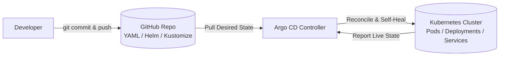

<p align="center">
  
</p>

<h1 align="center">🚀 Argo CD & GitOps Master Guide — From Fundamentals to Production Architecture
</h1>

[](https://argoproj.github.io/cd/)
[](https://kubernetes.io/)
[](https://helm.sh/)
[](https://kustomize.io/)
[](https://argo-cd.readthedocs.io/)
[](https://github.com/Learning-Pages/My-ArgoCD-Lap.git)

> **Complete GitOps Handbook**: Deep-dive theory, core components, hands-on tutorials, interview questions, and a battle-tested enterprise implementation (**ShopSphere**) using the **App-of-Apps** pattern and **Matrix ApplicationSets**.
> 
> **Configured for Repository**: [`https://github.com/Learning-Pages/My-ArgoCD-Lap.git`](https://github.com/Learning-Pages/My-ArgoCD-Lap.git) *(Branch: `main`)*

---

## 📑 Table of Contents

- [PART I: FUNDAMENTALS & ARCHITECTURE](#part-i-fundamentals--architecture)
  - [1. What is Argo CD?](#1-what-is-argo-cd)
  - [2. Why Use Argo CD? (GitOps vs Traditional CI/CD)](#2-why-use-argo-cd-gitops-vs-traditional-cicd)
  - [3. End-to-End Workflow](#3-end-to-end-workflow)
  - [4. Core Components Deep Dive](#4-core-components-deep-dive)
  - [5. Key GitOps Concepts](#5-key-gitops-concepts)
- [PART II: INSTALLATION & ACCESS GUIDE](#part-ii-installation--access-guide)
  - [6. Local Kubernetes Cluster Setup with Kind](#6-local-kubernetes-cluster-setup-with-kind)
  - [7. Installing Argo CD (Minikube / Kind / EKS / AKS)](#7-installing-argo-cd)
  - [8. Accessing the Web UI](#8-accessing-the-web-ui)
  - [9. Admin Password Recovery & Reset (kubectl & bcrypt)](#9-admin-password-recovery--reset)
  - [10. Installing and Logging into the Argo CD CLI](#10-installing-and-logging-into-the-argo-cd-cli)
  - [11. Securing Accounts & RBAC Setup](#11-securing-accounts--rbac-setup)
- [PART III: SHOPSPHERE ENTERPRISE IMPLEMENTATION](#part-iii-shopsphere-enterprise-implementation)
  - [12. Enterprise App-of-Apps Topology](#12-enterprise-app-of-apps-topology)
  - [13. Repository Directory Structure](#13-repository-directory-structure)
  - [14. Corrected Bootstrap Manifests](#14-corrected-bootstrap-manifests)
  - [15. 5-Minute Zero-to-Live Bootstrap Runbook](#15-5-minute-zero-to-live-bootstrap-runbook)
  - [16. Zero-Plaintext Secret Management (SealedSecrets & ESO)](#16-zero-plaintext-secret-management)
  - [17. Environment Promotion Runbook (Dev → Staging → Prod)](#17-environment-promotion-runbook)
- [PART IV: OPERATIONS, CHEAT SHEET & INTERVIEW PREP](#part-iv-operations-cheat-sheet--interview-prep)
  - [18. Full Control Command Cheat Sheet](#18-full-control-command-cheat-sheet)
  - [19. Troubleshooting & Common Issues Matrix](#19-troubleshooting--common-issues-matrix)
  - [20. Production Best Practices](#20-production-best-practices)
  - [21. Top Interview Questions & Answers](#21-top-interview-questions--answers)
  - [22. Recommended Learning Path](#22-recommended-learning-path)

---

# PART I: FUNDAMENTALS & ARCHITECTURE

## 1. What is Argo CD?

Argo CD is a **declarative, GitOps continuous delivery (CD) tool for Kubernetes**.

It operates as an in-cluster controller that continuously compares the **desired state** (declared in your Git repository) with the **live state** (running inside your Kubernetes cluster) and reconciles any drift.



### The Core GitOps Equation:
1. **Source of Truth**: Git holds the complete specification of your infrastructure and application manifests.
2. **Pull Model**: Argo CD pulls changes from Git into Kubernetes (no cluster credentials exposed to external CI).
3. **Continuous Reconciliation**: If someone manually edits a live deployment with `kubectl`, Argo CD detects the configuration drift and reverts it.

---

## 2. Why Use Argo CD? (GitOps vs Traditional CI/CD)

### Without Argo CD (Traditional Push-based CI/CD):
- External CI runners (Jenkins, GitLab CI, GitHub Actions) require administrative cluster credentials (`kubeconfig`).
- If an admin runs `kubectl edit deployment` directly in the cluster, the cluster state drifts from Git, and nobody knows.
- Rollbacks require re-running entire CI build pipelines or manually tracking down old container tags.

### With Argo CD (GitOps Pull Model):
- **Zero Cluster Secrets in CI**: CI only pushes Docker images and updates Git manifests.
- **Automated Drift Detection & Self-Healing**: Live cluster state is continuously restored to Git specification.
- **Auditability**: Every change, deployment, and promotion is recorded in Git commit history.
- **Instant Rollbacks**: Running `git revert <commit-sha>` immediately restores the previous cluster state.
- **Centralized Dashboard**: Live visibility into all pods, health probes, logs, and network endpoints.

---

## 3. End-to-End Workflow

```
┌──────────────┐       ┌──────────────────────┐       ┌────────────────────────┐
│ 1. Developer │  ==>  │ 2. CI Pipeline       │  ==>  │ 3. Container Registry  │
│ pushes code  │       │ (Build & Run Tests)  │       │ (ghcr.io/app:v2.0)     │
└──────────────┘       └──────────┬───────────┘       └────────────────────────┘
                                  │
                                  ▼ Updates image tag
                       ┌──────────────────────┐
                       │ 4. Deployment Git    │
                       │ Repository (YAML)    │
                       └──────────┬───────────┘
                                  │ Argo CD detects diff
                                  ▼
                       ┌──────────────────────┐       ┌────────────────────────┐
                       │ 5. Argo CD           │  ==>  │ 6. Kubernetes Cluster │
                       │ ApplicationController│       │ (Pulls v2.0 image &    │
                       └──────────────────────┘       │  performs rolling-sync)│
                                                      └────────────────────────┘
```

> **Key Rule**: CI builds the image. Argo CD only deploys the configuration that references it.

---

## 4. Core Components Deep Dive

| Component | Responsibility | Failure Impact if Down |
| :--- | :--- | :--- |
| **`argocd-server`** (API Server) | Exposes Web UI, gRPC API, CLI access, RBAC enforcement, and SSO authentication. | Web UI and CLI become unreachable; running Kubernetes workloads are unaffected. |
| **`argocd-repo-server`** | Clones Git repositories and generates raw Kubernetes YAML using Helm, Kustomize, or plugins. | Argo CD cannot check out new commits or render Helm charts. |
| **`argocd-application-controller`** | The core reconciliation engine. Compares live state with desired state, detects drift, applies changes, and watches CRDs. | Automated sync and self-healing stop; existing pods continue running in cluster. |
| **`argocd-redis`** | In-memory cache storing repository manifests and cluster resource trees. | Decreased performance; repo-server must re-clone Git repos repeatedly. |
| **`argocd-dex-server`** | Identity broker enabling SSO integration (GitHub, Google, Okta, OIDC, SAML). | External SSO login fails (local `admin` account still works). |

---

## 5. Key GitOps Concepts

- **Application CRD**: A Kubernetes Custom Resource that connects a Git source (`repoURL`, `targetRevision`, `path`) to a destination (`server`, `namespace`).
- **Sync Status**:
  - `Synced`: The live Kubernetes state exactly matches the Git manifests.
  - `OutOfSync`: A difference exists between Git and the live cluster.
- **Health Status**:
  - `Healthy`: Pods are running, readiness probes pass, and endpoints are active.
  - `Progressing`: Rolling update in progress.
  - `Degraded`: CrashLoopBackOff, ImagePullBackOff, or failing probes.
  - `Missing`: Declared resource does not exist in cluster.
  - *(Note: An application can be `Synced` but `Degraded` if buggy code is pushed).*
- **Self-Healing (`selfHeal: true`)**: If someone alters the cluster manually via `kubectl`, Argo CD immediately reverts the change back to Git.
- **Pruning (`prune: true`)**: If a YAML file is deleted in Git, Argo CD automatically deletes the corresponding resource from the cluster.

---

# PART II: INSTALLATION & ACCESS GUIDE

## 6. Local Kubernetes Cluster Setup with Kind (Kubernetes-in-Docker)

### 6.1 What is Kind & Why Use It for Argo CD?
[Kind (Kubernetes in Docker)](https://kind.sigs.k8s.io/) runs entire local Kubernetes clusters using Docker containers as nodes. It is the premier tool for local GitOps testing because:
- **Instant Spin-up**: Launches a full multi-node Kubernetes cluster in ~30 seconds.
- **Ingress ExtraPortMappings**: Maps container ports `80` and `443` directly to your local host machine, allowing NGINX Ingress and Argo CD to receive traffic on `http://localhost` and `https://localhost` without cloud load balancers.
- **Air-Gapped Local Image Loading**: Allows testing custom container images locally via `kind load docker-image` without pushing to Docker Hub or GHCR.

### 6.2 Installing the Kind CLI
```bash
# Linux (AMD64)
curl -Lo ./kind https://kind.sigs.k8s.io/dl/v0.22.0/kind-linux-amd64
chmod +x ./kind
sudo mv ./kind /usr/local/bin/kind

# macOS (Homebrew)
brew install kind

# Windows (Chocolatey or winget)
choco install kind
# OR
winget install Kubernetes.kind
```

Verify installation:
```bash
kind version
```

### 6.3 Creating a Single-Node Kind Cluster (With Ingress Port Mappings)
To ensure the NGINX Ingress controller can bind to your host's ports 80 and 443, create the cluster using this configuration:

```bash
cat <<EOF | kind create cluster --name shopsphere --config=-
kind: Cluster
apiVersion: kind.x-k8s.io/v1alpha4
nodes:
  - role: control-plane
    kubeadmConfigPatches:
      - |
        kind: InitConfiguration
        nodeRegistration:
          kubeletExtraArgs:
            node-labels: "ingress-ready=true"
    extraPortMappings:
      - containerPort: 80
        hostPort: 80
        protocol: TCP
      - containerPort: 443
        hostPort: 443
        protocol: TCP
EOF
```

### 6.4 Creating a Multi-Node Kind Cluster (1 Control-Plane + 2 Workers)
For production-grade simulation (testing PodDisruptionBudgets, anti-affinity, and multi-node pod scheduling):

```bash
cat <<EOF | kind create cluster --name shopsphere-ha --config=-
kind: Cluster
apiVersion: kind.x-k8s.io/v1alpha4
nodes:
  - role: control-plane
    kubeadmConfigPatches:
      - |
        kind: InitConfiguration
        nodeRegistration:
          kubeletExtraArgs:
            node-labels: "ingress-ready=true"
    extraPortMappings:
      - containerPort: 80
        hostPort: 80
        protocol: TCP
      - containerPort: 443
        hostPort: 443
        protocol: TCP
  - role: worker
  - role: worker
EOF
```

### 6.5 Essential Kind Commands Cheat Sheet
```bash
# --- Cluster Lifecycle ---
kind get clusters                               # List all local Kind clusters
kind get nodes --name shopsphere                # List container nodes for the 'shopsphere' cluster
kubectl cluster-info --context kind-shopsphere  # Verify kubectl is pointing to Kind
kind delete cluster --name shopsphere           # Completely destroy the cluster and release Docker resources

# --- Local Image Loading (Test Without Pushing to Registry) ---
docker build -t ghcr.io/Learning-Pages/frontend:sha-3f9a1c2 ./src/frontend
kind load docker-image ghcr.io/Learning-Pages/frontend:sha-3f9a1c2 --name shopsphere

# --- Diagnostics & Troubleshooting ---
kind export logs --name shopsphere ./kind-logs   # Dump full cluster and kubelet logs for debugging
docker ps --filter "name=shopsphere"            # View the Docker container running the Kubernetes node
```

### 6.6 Common Kind Troubleshooting Tips
- **Port 80 or 443 already in use**: If Docker fails with `bind: address already in use`, another process (e.g. Apache, local NGINX, or IIS) is occupying port 80/443. Check with `sudo lsof -i :80 -i :443` and stop the conflicting service.
- **Docker Resources**: In Docker Desktop (Settings ➔ Resources), ensure at least **4 CPUs** and **6 GB RAM** are allocated so all 25 applications, Prometheus, and Grafana run smoothly.

---

## 7. Installing Argo CD

Works on Minikube, Kind, AKS, EKS, GKE, or any Kubernetes cluster with `kubectl`:

```bash
# 1. Create the dedicated namespace
kubectl create namespace argocd

# 2. Deploy Argo CD (pinned production release v2.11.3)
kubectl apply -n argocd --server-side --force-conflicts \
  -f https://raw.githubusercontent.com/argoproj/argo-cd/v2.11.3/manifests/install.yaml

# 3. Wait for all pods to reach Ready state
kubectl wait --for=condition=Ready pod --all -n argocd --timeout=300s
kubectl get pods -n argocd
```

---

## 7. Accessing the Web UI

### Option A: Port-Forward (Best for Local Learning & Kind/Minikube)
```bash
kubectl port-forward svc/argocd-server -n argocd 8080:443
```
- Open your browser to: `https://localhost:8080`
- *(The browser will show a self-signed certificate warning; click "Advanced" and proceed).*

### Option B: Direct Insecure Argument (Fixes Port-Forward TLS Loops & Connection Drops)
If port-forwarding fails, loops with HTTP 307 redirects, or gives certificate errors, configure `argocd-server` to run in `--insecure` mode using either of these two methods:

#### Method 1: Instant One-Liner Patch (Fastest)
```bash
# Append --insecure flag directly to argocd-server container arguments
kubectl -n argocd patch deployment argocd-server --type json \
  -p '[{"op":"add","path":"/spec/template/spec/containers/0/command/-","value":"--insecure"}]'

# Now port-forward HTTP directly:
kubectl port-forward svc/argocd-server -n argocd 8080:8080
```

#### Method 2: Directly Edit the Deployment Manifest (Interactive)
If the ConfigMap doesn't exist or doesn't apply, append the `--insecure` argument straight to the container definition:

1. Open the deployment manifest edit screen:
   ```bash
   kubectl edit deployment argocd-server -n argocd
   ```
2. Scroll down until you locate the `spec.template.spec.containers` block where it says `command:` and `- argocd-server`.
3. Add `- --insecure` directly underneath it:
   ```yaml
   spec:
     template:
       spec:
         containers:
         - name: argocd-server
           command:
           - argocd-server
           - --insecure
   ```
4. Save and exit the text editor:
   - If using **nano**: Press `Ctrl + O` then `Enter`, followed by `Ctrl + X`.
   - If using **vim**: Press `Esc`, type `:wq` and press `Enter`.
5. The pods will automatically roll over and fix the loop! You can now port-forward cleanly:
   ```bash
   kubectl port-forward svc/argocd-server -n argocd 8080:8080
   ```

### Option C: LoadBalancer (Cloud: EKS / AKS / GKE)
```bash
kubectl patch svc argocd-server -n argocd -p '{"spec": {"type": "LoadBalancer"}}'
kubectl get svc argocd-server -n argocd -w
```
Use the assigned `EXTERNAL-IP` to access the UI.

---

## 8. Admin Password Recovery & Reset

### Retrieve Initial Generated Password:
```bash
# CLI command
argocd admin initial-password -n argocd

# Or via kubectl jsonpath decode
kubectl -n argocd get secret argocd-initial-admin-secret \
  -o jsonpath="{.data.password}" | base64 -d; echo
```
- **Default Username**: `admin`

### Forgot or Lost Password? Reset via Bcrypt:
```bash
# 1. Generate bcrypt hash for your new password (e.g., 'MyNewPassword2026!')
NEW_HASH=$(argocd account bcrypt --password 'MyNewPassword2026!')

# 2. Patch the argocd-secret
kubectl -n argocd patch secret argocd-secret -p \
  "{\"stringData\": {\"admin.password\": \"$NEW_HASH\", \"admin.passwordMtime\": \"$(date +%FT%T%Z)\"}}"
```

---

## 9. Installing and Logging into the Argo CD CLI

### Installation:
```bash
# Linux
curl -sSL -o argocd https://github.com/argoproj/argo-cd/releases/latest/download/argocd-linux-amd64
sudo install -m 555 argocd /usr/local/bin/argocd && rm argocd

# macOS
brew install argocd

# Windows
choco install argocd-cli
```

### Logging In:
```bash
# 1. Standard API login (port-forward must be running):
ARGOCD_PW=$(kubectl -n argocd get secret argocd-initial-admin-secret -o jsonpath='{.data.password}' | base64 -d)
argocd login localhost:8080 --username admin --password "${ARGOCD_PW}" --insecure

# 2. Or Core Mode (direct cluster access without port-forward):
kubectl config set-context --current --namespace=argocd
argocd login --core
```

---

## 10. Securing Accounts & RBAC Setup

### Update Password and Delete Initial Secret:
```bash
argocd account update-password
kubectl -n argocd delete secret argocd-initial-admin-secret
```

### Configure RBAC Roles (`argocd-rbac-cm`):
```yaml
# kubectl edit configmap argocd-rbac-cm -n argocd
apiVersion: v1
kind: ConfigMap
metadata:
  name: argocd-rbac-cm
  namespace: argocd
data:
  policy.default: role:readonly
  policy.csv: |
    # Developers can view everything, but only sync Dev applications
    p, role:developer, applications, get, */*, allow
    p, role:developer, applications, sync, */*-dev, allow
    g, dev-team, role:developer

    # SREs have full administrative control
    p, role:sre, applications, *, */*, allow
    g, sre-team, role:sre
```

---

# PART III: SHOPSPHERE ENTERPRISE IMPLEMENTATION

## 11. Enterprise App-of-Apps Topology

```
                         ┌──────────────────────────────────────────────┐
                         │      Root Application (bootstrap/root-app)   │
                         │    https://github.com/Learning-Pages/        │
                         │             My-ArgoCD-Lap.git                │
                         │  targetRevision: master | path: bootstrap    │
                         └──────────────────────┬───────────────────────┘
                                                │
                        ┌───────────────────────┴───────────────────────┐
                        │                                               │
           ┌────────────▼───────────┐                     ┌─────────────▼──────────┐
           │  AppProject: platform  │                     │  AppProject: shopsphere│
           └────────────┬───────────┘                     └─────────────┬──────────┘
                        │                                               │
           ┌────────────▼──────────────┐             ┌──────────────────┴──────────────────┐
           │   platform-appset.yaml    │             │                                     │
           │ (git: infrastructure/*)   │             ▼                                     ▼
           └────────────┬──────────────┘  ┌─────────────────────────┐   ┌──────────────────────────┐
                        │                 │shopsphere-dev-staging   │   │ shopsphere-prod          │
                        │                 │(matrix: dev, staging)   │   │ (matrix: prod)           │
                        │                 │sync: prune=true         │   │ sync: prune=false (SAFE) │
                        │                 └───────────┬─────────────┘   └────────────┬─────────────┘
                        │                             │                              │
            ┌───────────┴───────────┐                 ▼                              ▼
            ▼                       ▼          12 Applications:               6 Applications:
     7 Platform Applications:                  • frontend-dev/staging         • frontend-prod
     • argocd (v2.11.3)                        • auth-dev/staging             • auth-prod
     • ingress-nginx (v4.11.3)                 • cart-dev/staging             • cart-prod
     • cert-manager (v1.16.1)                  • checkout-dev/staging         • checkout-prod
     • sealed-secrets (v2.16.1)                • catalog-dev/staging          • catalog-prod
     • external-secrets (v0.10.4)              • payments-dev/staging         • payments-prod
     • monitoring (v65.1.1)                                                   (HPA 4-30, PDB: 3,
                                                                               RateLimit: 100 req/s)
```

---

## 12. Repository Directory Tree

```text
My-ArgoCD-Lap/
├── README.md                                  # Complete documentation & commands
├── bootstrap/                                 # App-of-Apps entrypoint
│   ├── kustomization.yaml                     # Assembles projects and ApplicationSets
│   ├── projects.yaml                          # AppProject definitions with RBAC
│   └── root-app.yaml                          # Root application targeting bootstrap/
├── apps/                                      # ApplicationSet manifests
│   ├── platform-appset.yaml                   # Deploys /infrastructure components
│   ├── shopsphere-appset-dev-staging.yaml     # Matrix generator for dev & staging (prune: true)
│   └── shopsphere-appset-prod.yaml            # Matrix generator for prod (prune: false)
├── infrastructure/                            # Platform charts & Kustomize overlays
│   ├── argocd/ (namespace, kustomization, values, repo-secret)
│   ├── ingress-nginx/ (kustomization, values)
│   ├── cert-manager/ (kustomization, values)
│   ├── sealed-secrets/ (kustomization, values)
│   ├── external-secrets/ (kustomization, values)
│   └── monitoring/ (kube-prometheus-stack, values)
├── charts/shopsphere-service/                 # Unified microservice Helm chart
│   ├── Chart.yaml & values.yaml               # Pinned tags, probes, non-root securityContext
│   └── templates/                             # deployment, service, hpa, pdb, servicemonitor,
│                                              # networkpolicy (DNS port 53 egress), ingress
└── environments/                              # All 18 environment values overlays
    ├── dev/     (frontend, auth, cart, checkout, catalog, payments)
    ├── staging/ (frontend, auth, cart, checkout, catalog, payments)
    └── prod/    (frontend, auth, cart, checkout, catalog, payments)
```

---

## 13. Corrected Bootstrap Manifests

### A. Root Application (`bootstrap/root-app.yaml`)
> **Crucial Fixes**:
> 1. `targetRevision: master` (matches your repository's default branch).
> 2. `path: bootstrap` (points directly to the directory, not `My-ArgoCD-Lap/bootstrap`).

```yaml
apiVersion: argoproj.io/v1alpha1
kind: Application
metadata:
  name: root
  namespace: argocd
  finalizers:
    - resources-finalizer.argocd.argoproj.io
spec:
  project: platform
  source:
    repoURL: https://github.com/Learning-Pages/My-ArgoCD-Lap.git
    targetRevision: master
    path: bootstrap
  destination:
    server: https://kubernetes.default.svc
    namespace: argocd
  syncPolicy:
    automated:
      prune: true
      selfHeal: true
    syncOptions:
      - CreateNamespace=true
      - ServerSideApply=true
    retry:
      limit: 5
      backoff: { duration: 5s, factor: 2, maxDuration: 3m }
```

### B. Bootstrap Kustomization (`bootstrap/kustomization.yaml`)
```yaml
apiVersion: kustomize.config.k8s.io/v1beta1
kind: Kustomization
resources:
  - projects.yaml
  - ../apps/platform-appset.yaml
  - ../apps/shopsphere-appset-dev-staging.yaml
  - ../apps/shopsphere-appset-prod.yaml
```

---

## 14. 5-Minute Zero-to-Live Bootstrap Runbook

```bash
# 1. Clone your repository
git clone https://github.com/Learning-Pages/My-ArgoCD-Lap.git
cd My-ArgoCD-Lap

# 2. Create Kind cluster with Ingress port mappings (80 & 443)
cat <<EOF | kind create cluster --name shopsphere --config=-
kind: Cluster
apiVersion: kind.x-k8s.io/v1alpha4
nodes:
  - role: control-plane
    extraPortMappings:
      - { containerPort: 80,  hostPort: 80,  protocol: TCP }
      - { containerPort: 443, hostPort: 443, protocol: TCP }
EOF

# 3. Deploy Argo CD (the only manual step)
kubectl apply -k infrastructure/argocd/
kubectl -n argocd rollout status deploy/argocd-server --timeout=10m

# 4. If your GitHub repository is private, apply credentials:
export GITHUB_TOKEN="ghp_yourTokenHere"
kubectl create secret generic shopsphere-repo -n argocd \
  --from-literal=type=git \
  --from-literal=url="https://github.com/Learning-Pages/My-ArgoCD-Lap.git" \
  --from-literal=username=git \
  --from-literal=password="${GITHUB_TOKEN}" \
  --save-config --dry-run=client -o yaml | kubectl apply -f -
kubectl -n argocd label secret shopsphere-repo "argocd.argoproj.io/secret-type=repository" --overwrite

# 5. Bootstrap App-of-Apps
kubectl apply -f bootstrap/projects.yaml
kubectl apply -f bootstrap/root-app.yaml

# 6. Watch all 25 applications sync
kubectl -n argocd get applications -w
```

---

## 15. Zero-Plaintext Secret Management

### Bitnami Sealed Secrets:
```bash
# 1. Fetch cluster public key
kubeseal --fetch-cert \
  --controller-name=sealed-secrets-controller \
  --controller-namespace=sealed-secrets > pub-sealed-secrets.pem

# 2. Encrypt secret directly into a commit-safe SealedSecret manifest
kubectl create secret generic checkout-db-secret \
  --namespace shopsphere-prod \
  --from-literal=password='SuperSecretProdPW123!' \
  --dry-run=client -o yaml | \
  kubeseal --format yaml --cert pub-sealed-secrets.pem > environments/prod/sealed-checkout-secret.yaml

# 3. Commit safely to Git
git add environments/prod/sealed-checkout-secret.yaml
git commit -m "chore: add sealed checkout secret" && git push origin master
```

---

## 16. Environment Promotion Runbook

```
Dev (tag: sha-abc1234)  ──[Smoke Test]──>  Staging (replicas: 2)  ──[SRE Approval]──>  Prod (tag: 2.4.1, PDB: 3)
```

```bash
# 1. Dev Promotion (Automated by CI upon container build)
sed -i 's/tag: .*/tag: sha-3f9a1c2/' environments/dev/values-cart.yaml
git commit -am "ci: deploy cart sha-3f9a1c2 to dev" && git push origin master

# 2. Staging Promotion (Automated PR for integration tests)
sed -i 's/tag: .*/tag: sha-3f9a1c2/' environments/staging/values-cart.yaml
git commit -am "chore(staging): promote cart to staging" && git push origin master

# 3. Production Release (SemVer tagged release)
sed -i 's/tag: .*/tag: "2.4.1"/' environments/prod/values-cart.yaml
git commit -am "release(cart): version 2.4.1 to prod" && git push origin master
```

---

# PART IV: OPERATIONS, CHEAT SHEET & INTERVIEW PREP

## 17. Full Control Command Cheat Sheet

```bash
# --- Status & Listing ---
argocd app list                                          # List all applications with sync and health status
argocd app get frontend-prod                             # Detailed status of production frontend
argocd app get root --hard-refresh                       # Bypass Git cache and force fresh checkout

# --- Synchronization ---
argocd app sync frontend-dev                             # Sync a single app
argocd app sync -l env=prod                              # Sync all production apps
argocd app sync frontend-prod --prune                    # Force manual prune on prod

# --- Diffs & Rollbacks ---
argocd app diff frontend-prod                            # View live diff between Git and Kubernetes
argocd app history frontend-prod                         # View deployment revision history
argocd app rollback frontend-prod 2                      # Roll back to revision 2 (requires auto-sync off)

# --- Logs & Monitoring ---
argocd app logs frontend-prod --follow                   # Stream live container logs
kubectl get hpa -n shopsphere-prod                       # Check Autoscalers (min: 4, max: 30)
kubectl get pdb -n shopsphere-prod                       # Check PodDisruptionBudgets (minAvailable: 3)
```

---

## 18. Troubleshooting & Common Issues Matrix

| Symptom | Root Cause | Immediate Terminal Fix |
| :--- | :--- | :--- |
| **`Select at least one resource` (Sync UI)** | Checkboxes under `SYNCHRONIZE RESOURCES` are unchecked, or Git branch is mismatched. | In UI, click `[✓] Select All` before clicking Synchronize, or run CLI: `argocd app sync root`. |
| **`Branch not found` / 0 manifests rendered** | Git branch is `master`, but manifest declared `targetRevision: main`. | Update `root-app.yaml` to `targetRevision: master` and verify `path: bootstrap`. |
| **`values-X.yaml: no such file`** | Missing overlay file for one of the 6 microservices. | Ensure all 18 files exist: `ls -la environments/dev/ environments/staging/ environments/prod/` |
| **`ComparisonError: repo not found`** | Private GitHub repository without credentials in Argo CD. | Apply secret: `kubectl apply -f infrastructure/argocd/repo-secret.yaml`. |
| **`Platform apps OutOfSync forever`** | Kustomize `helmCharts` requires `--enable-helm` on `argocd-repo-server`. | Patch ConfigMap: `kubectl -n argocd patch cm argocd-cm --type merge -p '{"data":{"kustomize.buildOptions":"--enable-helm"}}'`. |
| **`shopsphere-prod won't prune deleted manifests`** | `prune: false` is active by design in production for safety. | Trigger intentional manual prune: `argocd app sync <service>-prod --prune`. |
| **`cert-manager CRDs OutOfSync`** | CRD manifests exceed client-side 256kb apply limits. | Solved via `ServerSideApply=true` in `platform-appset.yaml`. |
| **`ImagePullBackOff` on Service Pods** | Placeholder images not yet pushed to container registry. | Build and push real image: `docker build -t ghcr.io/Learning-Pages/frontend:sha-3f9a1c2 .`. |

---

## 19. Production Best Practices

1. **Protect Production with `prune: false`**: Never enable automated pruning in production. Accidental file renames or deletions in Git must not cause instant production downtime.
2. **Use `$values/...` Root Reference**: Helm value files in ApplicationSets should always use `$values/environments/...` so Argo CD resolves paths from the repository root regardless of chart depth.
3. **Always Add Resource Finalizers**: Ensure `resources-finalizer.argocd.argoproj.io` is on every Application to prevent orphaned resources during teardown.
4. **Permit DNS Egress in NetworkPolicies**: Non-root container pods must explicitly have UDP/TCP port 53 egress permitted to `kube-system` to resolve CoreDNS.
5. **Pin Releases**: Never use `:latest` or mutable tags in production. Use Git commit SHAs (`sha-3f9a1c2`) in Dev/Staging and SemVer tags (`v2.4.1`) in Production.

---

## 20. Top Interview Questions & Answers

**Q1: What is Argo CD and how does it fit into a DevOps pipeline?**  
> **Ans:** Argo CD is a declarative GitOps continuous delivery tool for Kubernetes. While CI tools (Jenkins, GitHub Actions) compile code, run tests, and push container images, Argo CD is responsible for deploying and continuously reconciling those manifests into the Kubernetes cluster.

**Q2: What is the difference between `Synced` and `Healthy`?**  
> **Ans:** `Synced` means the live Kubernetes resource specifications match the Git declarations. `Healthy` means the resources are functioning properly (pods are running, endpoints ready). An application can be `Synced` but `Degraded` (e.g., if code crashes with `CrashLoopBackOff`).

**Q3: What is Configuration Drift and how does Argo CD handle it?**  
> **Ans:** Configuration drift occurs when someone manually changes cluster resources (e.g. `kubectl scale --replicas=10`) outside of Git. Argo CD flags the app as `OutOfSync`. If `selfHeal: true` is configured, Argo CD automatically reverts the live cluster back to the Git declaration.

**Q4: How does rollback work in GitOps?**  
> **Ans:** In pure GitOps, rollbacks are performed via Git: `git revert <commit-sha> && git push`. Argo CD detects the reverted commit and applies the previous stable state. While `argocd app rollback` exists, it disables automated sync and should only be used for emergency triage.

**Q5: What is the App-of-Apps pattern?**  
> **Ans:** An architectural pattern where a single "Root Application" in Argo CD manages and generates other Argo CD Applications and ApplicationSets. This allows an entire cluster with dozens of microservices and platform tools to be bootstrapped by applying a single YAML file.

---

## 21. Recommended Learning Path

1. **Kubernetes Core**: Pods, Deployments, Services, Ingress, Namespaces, ConfigMaps, Secrets, RBAC.
2. **Declarative Packaging**: Helm charts, Kustomize overlays.
3. **Local Practice**: Kind / Minikube cluster setup + Argo CD installation.
4. **GitOps Automation**: Setting up `root-app`, automated sync, and self-healing.
5. **Enterprise Delivery**: ApplicationSets, Sealed Secrets, Prometheus monitoring, and zero-downtime rolling updates.

---

*ShopSphere GitOps Manual — Maintained for Zero-Downtime Releases and High-Availability Kubernetes Operations.*
