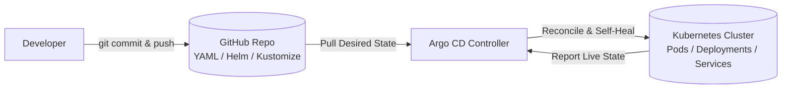

<p align="center">
  
</p>

<h1 align="center">🚀 Argo CD & GitOps Master Guide — From Fundamentals to Production Architecture</h1>

[](https://argoproj.github.io/cd/)
[](https://kubernetes.io/)
[](https://helm.sh/)
[](https://kubectl.docs.kubernetes.io/guides/introduction/kustomize/)
[](https://argo-cd.readthedocs.io/)
[](https://github.com/Learning-Pages/My-ArgoCD-Lap.git)

> **Complete GitOps Handbook** — Deep-dive theory, core components, hands-on tutorials, interview questions, and a battle-tested enterprise implementation (**ShopSphere**) using the **App-of-Apps** pattern and **Matrix ApplicationSets**.
>
> **Configured Repository**: [`https://github.com/Learning-Pages/My-ArgoCD-Lap.git`](https://github.com/Learning-Pages/My-ArgoCD-Lap.git) *(Branch: `main`)*

---

## 📑 Table of Contents

- [PART I — FUNDAMENTALS & ARCHITECTURE](#part-i--fundamentals--architecture)
  - [1. What is Argo CD?](#1-what-is-argo-cd)
  - [2. Why Use Argo CD?](#2-why-use-argo-cd)
  - [3. End-to-End Workflow](#3-end-to-end-workflow)
  - [4. Core Components Deep Dive](#4-core-components-deep-dive)
  - [5. Key GitOps Concepts](#5-key-gitops-concepts)
- [PART II — INSTALLATION & ACCESS](#part-ii--installation--access)
  - [6. Local Kubernetes Cluster with Kind](#6-local-kubernetes-cluster-with-kind)
  - [7. Installing Argo CD](#7-installing-argo-cd)
  - [8. Accessing the Web UI](#8-accessing-the-web-ui)
  - [9. Admin Password Recovery & Reset](#9-admin-password-recovery--reset)
  - [10. Installing the Argo CD CLI](#10-installing-the-argo-cd-cli)
  - [11. Securing Accounts & RBAC](#11-securing-accounts--rbac)
- [PART III — SHOPSPHERE ENTERPRISE IMPLEMENTATION](#part-iii--shopsphere-enterprise-implementation)
  - [12. Enterprise App-of-Apps Topology](#12-enterprise-app-of-apps-topology)
  - [13. Repository Directory Tree](#13-repository-directory-tree)
  - [14. Bootstrap Manifests](#14-bootstrap-manifests)
  - [15. 5-Minute Zero-to-Live Bootstrap Runbook](#15-5-minute-zero-to-live-bootstrap-runbook)
  - [16. Zero-Plaintext Secret Management](#16-zero-plaintext-secret-management)
  - [17. Environment Promotion Runbook](#17-environment-promotion-runbook)
- [PART IV — OPERATIONS, CHEAT SHEET & INTERVIEW PREP](#part-iv--operations-cheat-sheet--interview-prep)
  - [18. Full Control Command Cheat Sheet](#18-full-control-command-cheat-sheet)
  - [19. Troubleshooting & Common Issues](#19-troubleshooting--common-issues)
  - [20. Production Best Practices](#20-production-best-practices)
  - [21. Top Interview Questions & Answers](#21-top-interview-questions--answers)
  - [22. Recommended Learning Path](#22-recommended-learning-path)
  - [Appendix A — Complete File Contents](#appendix-a--complete-file-contents)

---

# PART I — FUNDAMENTALS & ARCHITECTURE

## 1. What is Argo CD?

Argo CD is a **declarative, GitOps continuous delivery (CD) tool for Kubernetes**.

It runs as an in-cluster controller that continuously compares the **desired state** (declared in your Git repository) with the **live state** (running inside your Kubernetes cluster) and reconciles any drift.

## 2. End-to-End Workflow

```text
┌──────────────┐       ┌──────────────────────┐       ┌────────────────────────┐
│ 1. Developer │  ==>  │ 2. CI Pipeline       │  ==>  │ 3. Container Registry  │
│ pushes code  │       │ (Build & Run Tests)  │       │ (ghcr.io/app:v2.0)     │
└──────────────┘       └──────────┬───────────┘       └────────────────────────┘
                                  │
                                  ▼ Updates image tag
                       ┌──────────────────────┐
                       │ 4. Deployment Git    │
                       │ Repository (YAML)    │
                       └──────────┬───────────┘
                                  │ Argo CD detects diff
                                  ▼
                       ┌──────────────────────┐       ┌────────────────────────┐
                       │ 5. Argo CD           │  ==>  │ 6. Kubernetes Cluster │
                       │ ApplicationController│       │ (Pulls v2.0 image &    │
                       └──────────────────────┘       │  performs rolling-sync)│
                                                      └────────────────────────┘
```

> **Key Rule**: CI builds the image. Argo CD only deploys the configuration that references it.

**Flow:**


## 3.The Core GitOps Equation

1. **Source of Truth** — Git holds the complete specification of your infrastructure and application manifests.
2. **Pull Model** — Argo CD pulls changes from Git into Kubernetes (no cluster credentials exposed to external CI).
3. **Continuous Reconciliation** — If someone manually edits a live deployment with `kubectl`, Argo CD detects drift and reverts it.

---

## 2. Why Use Argo CD?

### Without Argo CD (Traditional Push-based CI/CD)
- External CI runners (Jenkins, GitLab CI, GitHub Actions) require administrative cluster credentials (`kubeconfig`).
- Manual `kubectl edit` operations cause silent drift from Git.
- Rollbacks require re-running entire CI pipelines.

### With Argo CD (GitOps Pull Model)
- **Zero Cluster Secrets in CI** — CI only pushes images and updates Git manifests.
- **Automated Drift Detection & Self-Healing** — Live state is continuously restored to Git specification.
- **Auditability** — Every change, deployment, and promotion is recorded in Git commit history.
- **Instant Rollbacks** — `git revert <commit-sha>` immediately restores the previous cluster state.
- **Centralized Dashboard** — Live visibility into pods, health probes, logs, and endpoints.

---

## 4. Core Components Deep Dive

| Component | Responsibility | Impact if Down |
| :--- | :--- | :--- |
| **`argocd-server`** | Exposes Web UI, gRPC API, CLI, RBAC, SSO. | UI/CLI unreachable; workloads unaffected. |
| **`argocd-repo-server`** | Clones Git repos; renders Helm / Kustomize / plugins. | Cannot pull new commits or render charts. |
| **`argocd-application-controller`** | Core reconciliation engine; compares desired vs live and applies changes. | Automated sync and self-heal stop; existing pods continue running. |
| **`argocd-redis`** | In-memory cache for manifests and resource trees. | Slower performance; repo-server re-clones repeatedly. |
| **`argocd-dex-server`** | Identity broker for SSO (GitHub, Google, Okta, OIDC, SAML). | External SSO fails; local `admin` still works. |

---

## 5. Key GitOps Concepts

- **Application CRD** — Connects a Git source (`repoURL`, `targetRevision`, `path`) to a destination (`server`, `namespace`).
- **Sync Status**
  - `Synced` — Live state exactly matches Git.
  - `OutOfSync` — A difference exists.
- **Health Status**
  - `Healthy` — Pods running, readiness passing, endpoints active.
  - `Progressing` — Rolling update in progress.
  - `Degraded` — CrashLoopBackOff, ImagePullBackOff, failing probes.
  - `Missing` — Declared resource does not exist.
  - *An application can be `Synced` but `Degraded` (buggy code pushed).*
- **Self-Healing (`selfHeal: true`)** — Reverts manual `kubectl` changes back to Git.
- **Pruning (`prune: true`)** — Deletes cluster resources when their YAML is removed from Git.

---

# PART II — INSTALLATION & ACCESS

## 6. Local Kubernetes Cluster with Kind

Kind (Kubernetes-in-Docker) runs full local clusters using Docker containers as nodes.

### 6.1 Install the Kind CLI

```bash
# Linux (AMD64)
curl -Lo ./kind https://kind.sigs.k8s.io/dl/v0.22.0/kind-linux-amd64
chmod +x ./kind && sudo mv ./kind /usr/local/bin/kind

# macOS
brew install kind

# Windows
choco install kind
# or
winget install Kubernetes.kind

kind version
```

**Version check (must be v0.20+ for full `extraPortMappings` support):**

```bash
kind --version | grep -E 'v0\.(2[0-9]|[3-9][0-9])' \
  || echo "⚠️ Upgrade kind to v0.20 or newer"
```

### 6.2 Single-Node Cluster (Ingress-ready)

```bash
cat <<EOF | kind create cluster --name shopsphere --config=-
kind: Cluster
apiVersion: kind.x-k8s.io/v1alpha4
nodes:
  - role: control-plane
    kubeadmConfigPatches:
      - |
        kind: InitConfiguration
        nodeRegistration:
          kubeletExtraArgs:
            node-labels: "ingress-ready=true"
    extraPortMappings:
      - containerPort: 80
        hostPort: 80
        protocol: TCP
      - containerPort: 443
        hostPort: 443
        protocol: TCP
EOF
```

### 6.3 Multi-Node Cluster (1 Control-Plane + 2 Workers)

```bash
cat <<EOF | kind create cluster --name shopsphere-ha --config=-
kind: Cluster
apiVersion: kind.x-k8s.io/v1alpha4
nodes:
  - role: control-plane
    kubeadmConfigPatches:
      - |
        kind: InitConfiguration
        nodeRegistration:
          kubeletExtraArgs:
            node-labels: "ingress-ready=true"
    extraPortMappings:
      - { containerPort: 80,  hostPort: 80,  protocol: TCP }
      - { containerPort: 443, hostPort: 443, protocol: TCP }
  - role: worker
  - role: worker
EOF
```

### 6.4 Kind Cheat Sheet

```bash
kind get clusters                                 # List clusters
kind get nodes --name shopsphere                  # List nodes
kubectl cluster-info --context kind-shopsphere    # Confirm kubectl context
kind delete cluster --name shopsphere             # Destroy cluster

# Load local image without pushing to a registry
docker build -t ghcr.io/Learning-Pages/frontend:sha-3f9a1c2 ./src/frontend
kind load docker-image ghcr.io/Learning-Pages/frontend:sha-3f9a1c2 --name shopsphere

# Diagnostics
kind export logs --name shopsphere ./kind-logs
docker ps --filter "name=shopsphere"
```

### 6.5 Troubleshooting Tips
- **Port 80/443 in use** — `sudo lsof -i :80 -i :443` and stop the conflicting process.
- **Docker resources** — Ensure at least **4 CPUs** and **6 GB RAM** in Docker Desktop.

---

## 7. Installing Argo CD

```bash
# 1. Dedicated namespace
kubectl create namespace argocd

# 2. Pinned production release v2.11.3
kubectl apply -n argocd --server-side --force-conflicts \
  -f https://raw.githubusercontent.com/argoproj/argo-cd/v2.11.3/manifests/install.yaml

# 3. Wait for readiness
kubectl wait --for=condition=Ready pod --all -n argocd --timeout=300s
kubectl get pods -n argocd
```

---

## 8. Accessing the Web UI

### Option A — Port-Forward (Local Learning)

```bash
kubectl port-forward svc/argocd-server -n argocd 8080:443
```

Open `https://localhost:8080` and accept the self-signed certificate.

### Option B — Insecure Mode (Fixes Port-Forward Loops)

**Method 1 — One-Liner Patch**

```bash
kubectl -n argocd patch deployment argocd-server --type json \
  -p '[{"op":"add","path":"/spec/template/spec/containers/0/command/-","value":"--insecure"}]'

kubectl port-forward svc/argocd-server -n argocd 8080:8080
```

**Method 2 — Edit Deployment**

```bash
kubectl edit deployment argocd-server -n argocd
```

Add `- --insecure` directly under `- argocd-server`:

```yaml
spec:
  template:
    spec:
      containers:
      - name: argocd-server
        command:
        - argocd-server
        - --insecure
```

Save (`Ctrl+O`, `Enter`, `Ctrl+X` in nano; `:wq` in vim). Pods roll over automatically.

### Option C — LoadBalancer (Cloud: EKS / AKS / GKE)

```bash
kubectl patch svc argocd-server -n argocd -p '{"spec": {"type": "LoadBalancer"}}'
kubectl get svc argocd-server -n argocd -w
```

---

## 9. Admin Password Recovery & Reset

### Retrieve Initial Password

```bash
argocd admin initial-password -n argocd

# Or via kubectl
kubectl -n argocd get secret argocd-initial-admin-secret \
  -o jsonpath="{.data.password}" | base64 -d; echo
```

**Default username**: `admin`

### Reset via Bcrypt

```bash
NEW_HASH=$(argocd account bcrypt --password 'MyNewPassword2026!')

kubectl -n argocd patch secret argocd-secret -p \
  "{\"stringData\": {\"admin.password\": \"$NEW_HASH\", \"admin.passwordMtime\": \"$(date +%FT%T%Z)\"}}"
```

---

## 10. Installing the Argo CD CLI

```bash
# Linux
curl -sSL -o argocd https://github.com/argoproj/argo-cd/releases/latest/download/argocd-linux-amd64
sudo install -m 555 argocd /usr/local/bin/argocd && rm argocd

# macOS
brew install argocd

# Windows
choco install argocd-cli
```

### Logging In

```bash
# Standard API login (port-forward must be running)
ARGOCD_PW=$(kubectl -n argocd get secret argocd-initial-admin-secret \
  -o jsonpath='{.data.password}' | base64 -d)
argocd login localhost:8080 --username admin --password "${ARGOCD_PW}" --insecure

# Core Mode (direct cluster access, no port-forward)
kubectl config set-context --current --namespace=argocd
argocd login --core
```

---

## 11. Securing Accounts & RBAC

### Update Password + Delete Initial Secret

```bash
argocd account update-password
kubectl -n argocd delete secret argocd-initial-admin-secret
```

### Configure RBAC (`argocd-rbac-cm`)

```yaml
# kubectl edit configmap argocd-rbac-cm -n argocd
apiVersion: v1
kind: ConfigMap
metadata:
  name: argocd-rbac-cm
  namespace: argocd
data:
  policy.default: role:readonly
  policy.csv: |
    # Developers can view everything, but only sync Dev applications
    p, role:developer, applications, get, */*, allow
    p, role:developer, applications, sync, */*-dev, allow
    g, dev-team, role:developer

    # SREs have full administrative control
    p, role:sre, applications, *, */*, allow
    g, sre-team, role:sre
```

---

# PART III — SHOPSPHERE ENTERPRISE IMPLEMENTATION

## 12. Enterprise App-of-Apps Topology

```text
                         ┌──────────────────────────────────────────────┐
                         │      Root Application (bootstrap/root-app)   │
                         │    https://github.com/Learning-Pages/        │
                         │             My-ArgoCD-Lap.git                │
                         │  targetRevision: master | path: bootstrap    │
                         └──────────────────────┬───────────────────────┘
                                                │
                        ┌───────────────────────┴───────────────────────┐
                        │                                               │
           ┌────────────▼───────────┐                     ┌─────────────▼──────────┐
           │  AppProject: platform  │                     │  AppProject: shopsphere│
           └────────────┬───────────┘                     └─────────────┬──────────┘
                        │                                               │
           ┌────────────▼──────────────┐             ┌──────────────────┴──────────────────┐
           │   platform-appset.yaml    │             │                                     │
           │ (git: infrastructure/*)   │             ▼                                     ▼
           └────────────┬──────────────┘  ┌─────────────────────────┐   ┌──────────────────────────┐
                        │                 │shopsphere-dev-staging   │   │ shopsphere-prod          │
                        │                 │(matrix: dev, staging)   │   │ (matrix: prod)           │
                        │                 │sync: prune=true         │   │ sync: prune=false (SAFE) │
                        │                 └───────────┬─────────────┘   └────────────┬─────────────┘
                        │                             │                              │
            ┌───────────┴───────────┐                 ▼                              ▼
            ▼                       ▼          12 Applications:               6 Applications:
     7 Platform Applications:                  • frontend-dev/staging         • frontend-prod
     • argocd (v2.11.3)                        • auth-dev/staging             • auth-prod
     • ingress-nginx (v4.11.3)                 • cart-dev/staging             • cart-prod
     • cert-manager (v1.16.1)                  • checkout-dev/staging         • checkout-prod
     • sealed-secrets (v2.16.1)                • catalog-dev/staging          • catalog-prod
     • external-secrets (v0.10.4)              • payments-dev/staging         • payments-prod
     • monitoring (v65.1.1)                                                   (HPA 4-30, PDB: 3,
                                                                               RateLimit: 100 req/s)
```

---

## 13. Repository Directory Tree

```text
My-ArgoCD-Lap/
├── README.md                                  # This file
├── bootstrap/                                 # App-of-Apps entrypoint
│   ├── kustomization.yaml                     # Assembles projects and ApplicationSets
│   ├── projects.yaml                          # AppProject definitions with RBAC
│   └── root-app.yaml                          # Root Application targeting bootstrap/
├── apps/                                      # ApplicationSet manifests
│   ├── platform-appset.yaml                   # Deploys /infrastructure components
│   ├── shopsphere-appset-dev-staging.yaml     # Matrix generator for dev & staging (prune: true)
│   └── shopsphere-appset-prod.yaml            # Matrix generator for prod (prune: false)
├── infrastructure/                            # Platform charts & Kustomize overlays
│   ├── argocd/ (namespace, kustomization, values, repo-secret)
│   ├── ingress-nginx/ (kustomization, values)
│   ├── cert-manager/ (kustomization, values)
│   ├── sealed-secrets/ (kustomization, values)
│   ├── external-secrets/ (kustomization, values)
│   └── monitoring/ (kube-prometheus-stack, values)
├── charts/shopsphere-service/                 # Unified microservice Helm chart
│   ├── Chart.yaml & values.yaml               # Pinned tags, probes, non-root securityContext
│   └── templates/                             # deployment, service, hpa, pdb, servicemonitor,
│                                              # networkpolicy (DNS port 53 egress), ingress
└── environments/                              # All 18 environment values overlays
    ├── dev/     (frontend, auth, cart, checkout, catalog, payments)
    ├── staging/ (frontend, auth, cart, checkout, catalog, payments)
    └── prod/    (frontend, auth, cart, checkout, catalog, payments)
```

---

## 14. Bootstrap Manifests

### A. Root Application — `bootstrap/root-app.yaml`

> **Key fixes:** `targetRevision: master` (matches repo default branch) and `path: .` with `directory.include: 'bootstrap/*.yaml'` so Argo CD can render files that the kustomization references from `../apps/`.

```yaml
apiVersion: argoproj.io/v1alpha1
kind: Application
metadata:
  name: root
  namespace: argocd
  finalizers:
    - resources-finalizer.argocd.argoproj.io
spec:
  project: platform
  source:
    repoURL: https://github.com/Learning-Pages/My-ArgoCD-Lap.git
    targetRevision: master
    path: .
    directory:
      include: 'bootstrap/*.yaml'
      recurse: false
  destination:
    server: https://kubernetes.default.svc
    namespace: argocd
  syncPolicy:
    automated:
      prune: true
      selfHeal: true
    syncOptions:
      - CreateNamespace=true
      - ServerSideApply=true
    retry:
      limit: 5
      backoff: { duration: 5s, factor: 2, maxDuration: 3m }
```

> **Alternative:** if you prefer `path: bootstrap`, copy the three ApplicationSet files into `bootstrap/` and use plain `path: bootstrap`. Both work; the `directory.include` form avoids file duplication.

### B. Bootstrap Kustomization — `bootstrap/kustomization.yaml`

```yaml
apiVersion: kustomize.config.k8s.io/v1beta1
kind: Kustomization
resources:
  - projects.yaml
  - ../apps/platform-appset.yaml
  - ../apps/shopsphere-appset-dev-staging.yaml
  - ../apps/shopsphere-appset-prod.yaml
```

---

## 15. 5-Minute Zero-to-Live Bootstrap Runbook

```bash
# 0. Verify prerequisites
kind --version | grep -E 'v0\.(2[0-9]|[3-9][0-9])' \
  || { echo "⚠️ Upgrade kind to v0.20+"; exit 1; }
kubectl version --client

# 1. Clone the repository
git clone https://github.com/Learning-Pages/My-ArgoCD-Lap.git
cd My-ArgoCD-Lap

# 2. Create Kind cluster with ingress ports (80/443)
cat <<EOF | kind create cluster --name shopsphere --config=-
kind: Cluster
apiVersion: kind.x-k8s.io/v1alpha4
nodes:
  - role: control-plane
    extraPortMappings:
      - { containerPort: 80,  hostPort: 80,  protocol: TCP }
      - { containerPort: 443, hostPort: 443, protocol: TCP }
EOF

# 3. Deploy Argo CD (only manual step)
kubectl apply -k infrastructure/argocd/
kubectl -n argocd rollout status deploy/argocd-server --timeout=10m

# 4. (Private repos only) Register Git credentials
export GITHUB_TOKEN="ghp_yourTokenHere"
kubectl create secret generic shopsphere-repo -n argocd \
  --from-literal=type=git \
  --from-literal=url="https://github.com/Learning-Pages/My-ArgoCD-Lap.git" \
  --from-literal=username=git \
  --from-literal=password="${GITHUB_TOKEN}" \
  --save-config --dry-run=client -o yaml | kubectl apply -f -
kubectl -n argocd label secret shopsphere-repo "argocd.argoproj.io/secret-type=repository" --overwrite

# 5. Bootstrap App-of-Apps
kubectl apply -f bootstrap/projects.yaml
kubectl apply -f bootstrap/root-app.yaml

# 6. Wait for the root app, then all children
argocd app wait root --sync --health --timeout 600
kubectl -n argocd get applications

# Optional: watch live updates
kubectl -n argocd get applications -w
```

---

## 16. Zero-Plaintext Secret Management

### Bitnami Sealed Secrets

```bash
# 1. Fetch cluster public key
kubeseal --fetch-cert \
  --controller-name=sealed-secrets-controller \
  --controller-namespace=sealed-secrets > pub-sealed-secrets.pem

# 2. Encrypt a secret into a commit-safe manifest
kubectl create secret generic checkout-db-secret \
  --namespace shopsphere-prod \
  --from-literal=password='SuperSecretProdPW123!' \
  --dry-run=client -o yaml | \
  kubeseal --format yaml --cert pub-sealed-secrets.pem > environments/prod/sealed-checkout-secret.yaml

# 3. Commit safely
git add environments/prod/sealed-checkout-secret.yaml
git commit -m "chore: add sealed checkout secret"
git push origin master
```

---

## 17. Environment Promotion Runbook

```text
Dev (tag: sha-abc1234) ──[Smoke Test]──▶ Staging (replicas: 2) ──[SRE Approval]──▶ Prod (tag: 2.4.1, PDB: 3)
```

```bash
# 1. Dev Promotion (automated by CI on image build)
sed -i 's/tag: .*/tag: sha-3f9a1c2/' environments/dev/values-cart.yaml
git commit -am "ci: deploy cart sha-3f9a1c2 to dev" && git push origin master

# 2. Staging Promotion (automated PR for integration tests)
sed -i 's/tag: .*/tag: sha-3f9a1c2/' environments/staging/values-cart.yaml
git commit -am "chore(staging): promote cart to staging" && git push origin master

# 3. Production Release (SemVer tag)
sed -i 's/tag: .*/tag: "2.4.1"/' environments/prod/values-cart.yaml
git commit -am "release(cart): version 2.4.1 to prod" && git push origin master
```

---

# PART IV — OPERATIONS, CHEAT SHEET & INTERVIEW PREP

## 18. Full Control Command Cheat Sheet

```bash
# --- Status & Listing ---
argocd app list                                       # List all apps with sync + health
argocd app get frontend-prod                          # Detailed status
argocd app get root --hard-refresh                    # Bypass Git cache

# --- Synchronization ---
argocd app sync frontend-dev                          # Sync one app
argocd app sync -l env=prod                           # Sync all prod apps
argocd app sync frontend-prod --prune                 # Force manual prune

# --- Diffs & Rollbacks ---
argocd app diff frontend-prod                         # Show live diff vs Git
argocd app history frontend-prod                      # Revision history
argocd app rollback frontend-prod 2                   # Roll back to revision 2

# --- Logs & Monitoring ---
argocd app logs frontend-prod --follow                # Stream container logs
kubectl get hpa -n shopsphere-prod                    # Autoscalers (min: 4, max: 30)
kubectl get pdb -n shopsphere-prod                    # PodDisruptionBudgets (minAvailable: 3)

# --- Wait with timeout (avoids hanging scripts) ---
argocd app wait frontend-prod --sync --health --timeout 300
```

---

## 19. Troubleshooting & Common Issues

| Symptom | Root Cause | Fix |
| :--- | :--- | :--- |
| **`Select at least one resource`** | Checkboxes unchecked, or branch mismatch. | Click `[✓] Select All` in UI, or run `argocd app sync root`. |
| **`Branch not found` / 0 manifests** | Git branch is `master`, manifest uses `main`. | Update `root-app.yaml` → `targetRevision: master`, `path: .` with `directory.include`. |
| **`values-X.yaml: no such file`** | Missing overlay for a microservice. | `ls -la environments/dev/ environments/staging/ environments/prod/` — ensure all 18 files exist. |
| **`ComparisonError: repo not found`** | Private repo without credentials. | `kubectl apply -f infrastructure/argocd/repo-secret.yaml`. |
| **`Platform apps OutOfSync forever`** | Kustomize `helmCharts` requires `--enable-helm`. | `kubectl -n argocd patch cm argocd-cm --type merge -p '{"data":{"kustomize.buildOptions":"--enable-helm"}}'`. |
| **`shopsphere-prod won't prune`** | `prune: false` by design in prod. | Manual: `argocd app sync <service>-prod --prune`. |
| **`cert-manager CRDs OutOfSync`** | CRDs exceed client-side 256 KB limit. | `ServerSideApply=true` in `platform-appset.yaml`. |
| **`ImagePullBackOff`** | Placeholder images not pushed. | `docker build -t ghcr.io/Learning-Pages/frontend:sha-3f9a1c2 .` and push. |
| **`file is outside allowed path`** | Kustomization references `../apps/` while root app has `path: bootstrap`. | Use `path: .` + `directory.include: 'bootstrap/*.yaml'` (see §14A). |

---

## 20. Production Best Practices

1. **Protect Production with `prune: false`** — Never enable automated pruning in production. A Git file rename must not cause instant downtime.
2. **Use `$values/...` Root Reference** — In ApplicationSets, always reference `$values/environments/...` so paths resolve from the repo root.
3. **Always Add Finalizers** — Set `resources-finalizer.argocd.argoproj.io` on every Application to prevent orphaned resources.
4. **Permit DNS Egress in NetworkPolicies** — Non-root pods need explicit UDP/TCP port 53 egress to `kube-system` for CoreDNS.
5. **Pin Releases** — Never use `:latest` or mutable tags. Use Git SHAs (`sha-3f9a1c2`) in Dev/Staging and SemVer tags (`v2.4.1`) in Prod.
6. **Timeout Every Wait** — `argocd app wait ... --timeout 300` in scripts; avoids CI hangs.
7. **Vendor the Argo CD logo** — Copy `docs/assets/logo.png` into your own repo to avoid upstream branch restructures breaking your header.

---

## 21. Top Interview Questions & Answers

**Q1. What is Argo CD and how does it fit into a DevOps pipeline?**
> Argo CD is a declarative GitOps CD tool for Kubernetes. CI tools (Jenkins, GitHub Actions) build images; Argo CD is responsible for deploying and continuously reconciling those manifests into the cluster.

**Q2. Difference between `Synced` and `Healthy`?**
> `Synced` = live specs match Git. `Healthy` = resources are functioning. An app can be `Synced` but `Degraded` (e.g., `CrashLoopBackOff`).

**Q3. What is Configuration Drift, and how does Argo CD handle it?**
> Drift occurs when someone changes the cluster manually (e.g., `kubectl scale`). Argo CD marks the app `OutOfSync`. With `selfHeal: true`, it auto-reverts to Git.

**Q4. How does rollback work in GitOps?**
> Preferred rollback is `git revert <sha> && git push`. Argo CD then applies the previous state. `argocd app rollback` exists but disables auto-sync, so use only for emergency triage.

**Q5. What is the App-of-Apps pattern?**
> A single "Root Application" manages other Argo CD Applications and ApplicationSets. An entire cluster with dozens of services and platform tools can be bootstrapped by applying one YAML file.

---

## 22. Recommended Learning Path

1. **Kubernetes Core** — Pods, Deployments, Services, Ingress, Namespaces, ConfigMaps, Secrets, RBAC.
2. **Declarative Packaging** — Helm charts, Kustomize overlays.
3. **Local Practice** — Kind / Minikube cluster + Argo CD installation.
4. **GitOps Automation** — `root-app`, automated sync, self-healing.
5. **Enterprise Delivery** — ApplicationSets, Sealed Secrets, Prometheus monitoring, zero-downtime rolling updates.

---

# Appendix A — Complete File Contents

All files referenced above, complete and ready to copy into the repo.

## A.1 `b

---

*ShopSphere GitOps Manual — Maintained for Zero-Downtime Releases and High-Availability Kubernetes Operations.*
