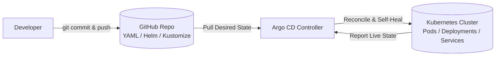

<p align="center">
  
</p>

<h1 align="center">🚀 Argo CD & GitOps Master Guide - From Fundamentals to Production Architecture
</h1>

[](https://argoproj.github.io/cd/)
[](https://kubernetes.io/)
[](https://helm.sh/)
[](https://kustomize.io/)
[](https://argo-cd.readthedocs.io/)
[](https://github.com/Learning-Pages/My-ArgoCD-Lap.git)

> **Complete GitOps Handbook**: Deep-dive theory, core components, hands-on tutorials, interview questions, and a battle-tested enterprise implementation (**ShopSphere**) using the **App-of-Apps** pattern and **Matrix ApplicationSets**.
> 
> **Configured for Repository**: [`https://github.com/Learning-Pages/My-ArgoCD-Lap.git`](https://github.com/Learning-Pages/My-ArgoCD-Lap.git) *(Branch: `main`)*

---

## 📑 Table of Contents

- [PART I: FUNDAMENTALS & ARCHITECTURE](#part-i-fundamentals--architecture)
  - [1. What is Argo CD?](#1-what-is-argo-cd)
  - [2. Why Use Argo CD? (GitOps vs Traditional CI/CD)](#2-why-use-argo-cd-gitops-vs-traditional-cicd)
  - [3. End-to-End Workflow](#3-end-to-end-workflow)
  - [4. Core Components Deep Dive](#4-core-components-deep-dive)
  - [5. Key GitOps Concepts](#5-key-gitops-concepts)
---

# PART I: FUNDAMENTALS & ARCHITECTURE

## 1. What is Argo CD?

Argo CD is a **declarative, GitOps continuous delivery (CD) tool for Kubernetes**.

It operates as an in-cluster controller that continuously compares the **desired state** (declared in your Git repository) with the **live state** (running inside your Kubernetes cluster) and reconciles any drift.



### The Core GitOps Equation:
1. **Source of Truth**: Git holds the complete specification of your infrastructure and application manifests.
2. **Pull Model**: Argo CD pulls changes from Git into Kubernetes (no cluster credentials exposed to external CI).
3. **Continuous Reconciliation**: If someone manually edits a live deployment with `kubectl`, Argo CD detects the configuration drift and reverts it.

---

## 2. Why Use Argo CD? (GitOps vs Traditional CI/CD)

### Without Argo CD (Traditional Push-based CI/CD):
- External CI runners (Jenkins, GitLab CI, GitHub Actions) require administrative cluster credentials (`kubeconfig`).
- If an admin runs `kubectl edit deployment` directly in the cluster, the cluster state drifts from Git, and nobody knows.
- Rollbacks require re-running entire CI build pipelines or manually tracking down old container tags.

### With Argo CD (GitOps Pull Model):
- **Zero Cluster Secrets in CI**: CI only pushes Docker images and updates Git manifests.
- **Automated Drift Detection & Self-Healing**: Live cluster state is continuously restored to Git specification.
- **Auditability**: Every change, deployment, and promotion is recorded in Git commit history.
- **Instant Rollbacks**: Running `git revert <commit-sha>` immediately restores the previous cluster state.
- **Centralized Dashboard**: Live visibility into all pods, health probes, logs, and network endpoints.

---

## 3. End-to-End Workflow

```
┌──────────────┐       ┌──────────────────────┐       ┌────────────────────────┐
│ 1. Developer │  ==>  │ 2. CI Pipeline       │  ==>  │ 3. Container Registry  │
│ pushes code  │       │ (Build & Run Tests)  │       │ (ghcr.io/app:v2.0)     │
└──────────────┘       └──────────┬───────────┘       └────────────────────────┘
                                  │
                                  ▼ Updates image tag
                       ┌──────────────────────┐
                       │ 4. Deployment Git    │
                       │ Repository (YAML)    │
                       └──────────┬───────────┘
                                  │ Argo CD detects diff
                                  ▼
                       ┌──────────────────────┐       ┌────────────────────────┐
                       │ 5. Argo CD           │  ==>  │ 6. Kubernetes Cluster │
                       │ ApplicationController│       │ (Pulls v2.0 image &    │
                       └──────────────────────┘       │  performs rolling-sync)│
                                                      └────────────────────────┘
```

> **Key Rule**: CI builds the image. Argo CD only deploys the configuration that references it.

---

## 4. Core Components Deep Dive

| Component | Responsibility | Failure Impact if Down |
| :--- | :--- | :--- |
| **`argocd-server`** (API Server) | Exposes Web UI, gRPC API, CLI access, RBAC enforcement, and SSO authentication. | Web UI and CLI become unreachable; running Kubernetes workloads are unaffected. |
| **`argocd-repo-server`** | Clones Git repositories and generates raw Kubernetes YAML using Helm, Kustomize, or plugins. | Argo CD cannot check out new commits or render Helm charts. |
| **`argocd-application-controller`** | The core reconciliation engine. Compares live state with desired state, detects drift, applies changes, and watches CRDs. | Automated sync and self-healing stop; existing pods continue running in cluster. |
| **`argocd-redis`** | In-memory cache storing repository manifests and cluster resource trees. | Decreased performance; repo-server must re-clone Git repos repeatedly. |
| **`argocd-dex-server`** | Identity broker enabling SSO integration (GitHub, Google, Okta, OIDC, SAML). | External SSO login fails (local `admin` account still works). |

---

## 5. Key GitOps Concepts

- **Application CRD**: A Kubernetes Custom Resource that connects a Git source (`repoURL`, `targetRevision`, `path`) to a destination (`server`, `namespace`).
- **Sync Status**:
  - `Synced`: The live Kubernetes state exactly matches the Git manifests.
  - `OutOfSync`: A difference exists between Git and the live cluster.
- **Health Status**:
  - `Healthy`: Pods are running, readiness probes pass, and endpoints are active.
  - `Progressing`: Rolling update in progress.
  - `Degraded`: CrashLoopBackOff, ImagePullBackOff, or failing probes.
  - `Missing`: Declared resource does not exist in cluster.
  - *(Note: An application can be `Synced` but `Degraded` if buggy code is pushed).*
- **Self-Healing (`selfHeal: true`)**: If someone alters the cluster manually via `kubectl`, Argo CD immediately reverts the change back to Git.
- **Pruning (`prune: true`)**: If a YAML file is deleted in Git, Argo CD automatically deletes the corresponding resource from the cluster.

---

*GitOps Manual — Maintained for Zero-Downtime Releases and High-Availability Kubernetes Operations.*
